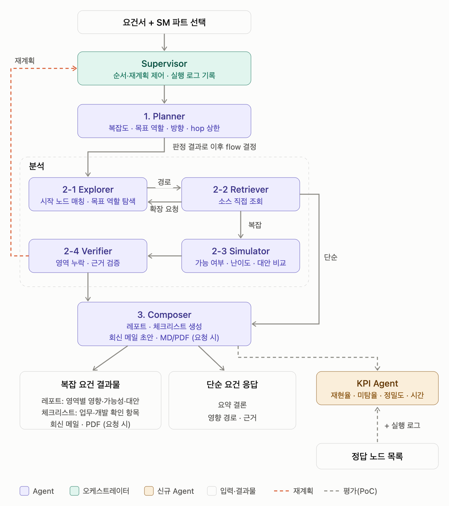

# Agent 설계서: Simulator · Verifier · Composer (v0.2 초안)

> 담당: **2-3 Simulator · 2-4 Verifier · 3 Composer · KPI Agent** (SE) / Supervisor · Planner · Explorer · Retriever ([YJ_agent_design.md](YJ_agent_design.md))
> 기준: [agent_workflow_diagram.png](agent_workflow_diagram.png) (최신 Agent Workflow), [data_structure_neo4j.svg](data_structure_neo4j.svg) (그래프 노드 구조 0~5단계). 작성일 2026-10-26. 미결 항목은 10장.

## 변경 이력

| 버전 | 변경 내용 |
|---|---|
| v0.1 | 최초 초안 |
| v0.2 | 난이도 기준 1차 확정(그래프 단계 반영), 근거 검증(`evidence_missing`) 확정, 경로 제외(`dropped_paths`) 가드 규칙, 영역 분류를 역할 라벨(`NodeRole`) 기준으로 변경, 재분석은 기존 후속 입력 흐름 사용, tos·swing 대응(8장) 추가 |

## 0. 한눈에 보기



```
… 2-2 Retriever ─(단순)──────────────────────────────────────────────┐
        │(복잡)                                                       ▼
        ▼                                                        3 Composer ──▶ 단순 요건 응답 / 복잡 요건 결과물
   2-3 Simulator  영역별 영향 · 가능성 · 난이도 · 대안                    ┆ (평가, PoC)
        ▼                                                              ▼
   2-4 Verifier   영역 누락 · 근거 검증 ─ 보완 필요 → 재계획(Supervisor → Planner, ≤ MAX_REPLAN)
        │ 통과 · 재계획 한도 초과                                  KPI Agent ◀┄ 정답 노드 목록 + 실행 로그
        ▼
   3 Composer
```

| 에이전트 | flow | 방식 | 입력 (AgentState) | 출력 | 구현 |
|---|---|---|---|---|---|
| 2-3 Simulator | 복잡 | 규칙(경로 골격) + LLM(영향·판정) | planner, explorer, retriever, replan_feedback | `SimulationOutput` | `agents/simulator.py`, `prompts/simulator.md` |
| 2-4 Verifier | 복잡 | 규칙 점검 + LLM(대안 근거) | planner, explorer, retriever, simulation, replan_feedback | `VerifierOutput` | `agents/verifier.py`, `prompts/verifier.md` |
| 3 Composer | 단순·복잡 | 코드(구조화 항목) + LLM(문장) + Jinja2 | 전체 + followups | `ComposerOutput` | `agents/composer.py`, `prompts/composer.md`, `templates/*.md.j2`, `tools/report.py` |

### 공통 원칙

- **규칙 먼저, LLM 은 보완.** yj 의 Explorer·Retriever 와 같은 방식이다. 노드·경로·근거 연결처럼 사실 확인이 되는 부분은 코드로 만들고, 영향 설명·판정 사유·결론 문장만 LLM 이 쓴다.
- **LLM 없이도 끝까지 실행된다.** LLM 키가 없거나 호출이 실패하면 규칙 결과만으로 출력을 만든다 (판정은 `review`, 문장은 규칙 문구). pytest 와 KPI 배치 평가가 LLM 없이 돈다. LLM 클라이언트는 `llm.react_llm()` 과 같은 방식으로 얻는다.
- **노드는 그래프 노드 ID 로 쓴다.** `PathHop.node` 는 반드시 `<접두어>:<키>` 그래프 ID 다 (복잡 flow 의 KPI `final_nodes` = Simulator 경로 노드).
- **영역별 라벨이 아니라 역할로 판단한다.** tos(Controller·Service·SQL)·swing(TP·Module·DBIO) 라벨 차이는 `GraphNode.role`(`NodeRole`) 로 흡수한다 (Explorer·Planner 와 같은 기준, 8장).
- **확인된 사실과 추정을 구분한다.** 근거(Evidence)가 있는 hop 만 `confirmed`, 나머지는 `inferred`. 근거 없이 구현 가능 여부를 확정하지 않고 `review` 로 둔다 (`prompts/_common.md`).
- **실행 로그.** LLM 을 쓴 에이전트는 `self.last_usage` 에 토큰 사용량을 남긴다 (Supervisor 가 `AgentRunRecord` 에 기록). tool 을 쓰면 출력의 `tool_call_count` 를 채운다.
- **Structured Output.** LLM 응답은 Pydantic 모델(`*Draft`)로 받고, 최종 출력 모델은 코드가 조립한다 (Planner 의 `PlannerDraft` 방식).

### 영역(Area) 분류 규칙

Simulator·Verifier·Composer 가 같은 함수(`rules.py`)를 쓴다. 판단 기준은 `GraphNode.role` 이다.

| 역할 (`NodeRole`) | tos / swing 라벨 | 영역 |
|---|---|---|
| Entry | Screen | screen |
| Entry | Batch | batch |
| EntryHandler, Logic | Controller·Service / TP·Module | 경로 진입 노드(Entry)의 영역 |
| DataAccess, Table, Column | SQL·DBIO / DBIO, Table, Column | db |
| (속성) | 노드 `properties.interfaces` 가 있거나 근거에 `source_kind=interface_spec` 이 있는 노드 | interface (위 영역에 추가) |
| (그래프 밖) | Explorer `unresolved` 의 그래프 밖 채널·전문 (`ExploreItem.out_of_graph`) | interface, 경로 없이 `unverified_segments` 로 |

- 경로 하나가 여러 영역에 걸칠 수 있다 (예: Screen → TP → Module → DBIO → Table 은 screen + db).
- 4개 영역을 항상 모두 출력한다. 경로가 없는 영역은 `impact_type=none` (Verifier 의 영역 누락 점검 기준).

---

## 1. Simulator (2-3)

**역할**: 복잡 요건에서 영역(screen / db / interface / batch)별 영향 경로를 구성하고, 구현 가능성·난이도·대안을 판정한다.

**입력**

| 필드 | 사용 |
|---|---|
| `planner.items` | 요건 항목(`item_id`·`text`)·변경 유형(`change_type`) → 영역별 영향 유형 판단 |
| `explorer.paths` | 경로 골격. `nodes` 는 탐색 방향과 관계없이 진입 → DB 순서, `item_id` 로 요건 항목과 연결 |
| `explorer.edges`, `explorer.nodes` | hop 관계(엣지 유형), 노드 역할·속성(`role`, `domain`, `properties`) |
| `explorer.item_results` | 목표 미도달(`reached=false`)·hop 상한(`frontier`)·매칭 실패(`unmatched_mentions`) → `unverified_segments` |
| `explorer.unresolved`, `explorer.excluded_common` | 분석 범위 밖 → `unverified_segments` |
| `retriever.evidence[]` (`content` 원문) | hop 근거(`evidence_ref`)·확신도, LLM 판단 근거 |
| `retriever.nodes_without_evidence` | 해당 hop 은 `inferred` |
| `replan_feedback` | 재계획 라운드면 이전 누락 사유 (같은 누락 반복 방지) |

**처리**

1. **경로 골격 (규칙)**: `explorer.paths` 마다 `ImpactPath` 를 만든다.
   - hop: `node` = 경로 노드 ID, `relation` = 앞 노드 → 이 노드 엣지 유형(`explorer.edges`, 첫 hop 은 `ENTRY`), `evidence_ref` = 해당 노드 Evidence 의 `file_path#location` (예: `source/java/BilService.java#L40-88`)
   - `confidence`: Evidence 가 있으면 `confirmed`, 없으면 `inferred`
   - 같은 노드 순서의 경로는 하나로 합친다. 경로 id 는 `P<item_id>-<n>`
   - `cross_domain`: 경로 노드의 `domain` 이 둘 이상 (swing ↔ tos = 상품 SM ↔ 마케팅 SM, `rules.SM_PART_DOMAINS`)
2. **영역 배정 (규칙)**: 위 영역 분류 규칙으로 경로를 영역에 배정한다.
3. **영향 판정 (LLM)**: 영역별로 경로·원문·요건 항목을 주고 `SimulatorDraft` 를 받는다.
   - hop 별 `impact` (이 노드에서 무엇이 바뀌는지 / 확인만 필요한지)
   - 영역별 `impact_type`(add / modify / reference_only / none), `feasibility`, `difficulty` + `difficulty_basis`, `schedule_factors`
   - `feasibility=hard` 면 `infeasible_reason` 과 `alternatives`(가능성·난이도·장단점) 필수
   - 요청안과 대안이 갈리면 `requested_vs_alternative` 에 비교 요약 (예: SC-001 신규 컬럼 추가 vs 기존 광고여부 변환)
   - 요건과 무관한 경로는 **제외 제안**과 사유를 낸다 (4단계 가드 통과 시에만 제외)
4. **판정 보정 (규칙)**: LLM 결과를 그대로 믿지 않는다.
   - LLM 이 그래프에 없는 노드를 hop 에 넣으면 버린다 (경로는 골격 노드만)
   - 영역의 hop 이 전부 `inferred` 이면 `feasibility` 를 `feasible` 로 확정하지 않고 `review`
   - 영역 `confidence` = hop 이 모두 `confirmed` 일 때만 `confirmed`
   - **경로 제외 가드**: 아래에 하나라도 해당하면 제외 제안을 거절하고 경로를 남긴다.
     - 목표 역할에 도달한 경로(`stop_reason=target_reached`)의 마지막 노드에 근거(`confirmed`)가 있음
     - 사용자가 확정한 노드(`Mention.confirmed_node`)가 경로에 있음
     - 그 경로를 빼면 요건 항목(`item_id`)의 경로가 하나도 남지 않음
   - 제외한 경로는 `dropped_paths` 에 사유와 함께 남기고, Composer 가 레포트에 "검토 제외 경로"로 보여준다 (사람이 확인 가능)
5. **분석 한계**: `explorer.unresolved`, `item_results` 의 미도달·frontier·매칭 실패, 근거 없는 노드, 공통 제외 노드를 `unverified_segments` 에 넣는다.
6. **LLM 없음**: 3단계를 건너뛰고 `impact` = "영향 검토 필요", `impact_type` = 경로 있음 `modify` / 없음 `none`, `feasibility=review`, `difficulty` = 아래 기준의 규칙 판정. 경로는 제외하지 않는다.

**경로 제외를 허용하는 이유**: Explorer 경로에는 요건과 무관한 분기가 섞인다 (yj 시나리오 기준 노드 정밀도 0.2 수준). 모두 레포트에 올리면 검토 부담이 커진다. 대신 KPI 의 최우선 목표가 Critical 미탐 0건이므로 가드 규칙으로 미탐 위험을 막고, 제외 내역은 사람이 볼 수 있게 남긴다.

**난이도 판단 기준 (1차 확정, `difficulty_basis` 에 적용 항목을 쓴다)**

변경(`impact_type` = add / modify)이 닿는 노드의 그래프 단계([data_structure_neo4j.svg](data_structure_neo4j.svg))와 영역 수로 판단한다.

| 난이도 | 기준 (하나라도 해당) | 그래프 단계 |
|---|---|---|
| Major | DB 스키마 변경(컬럼 추가·길이·타입) · 인터페이스 전문 레이아웃 변경 · 변경 영역 3개 이상 · 도메인 간 연계(`cross_domain`) | 5 Column 구조 변경, interface |
| Medium | 업무 로직 변경이 2개 이상 노드에 걸침 · 화면 항목 추가 + 저장 로직 변경 · 변경 영역 2개 | 2~3 Logic·DataAccess 다수 |
| Minor | 데이터·설정값·문구·이미지 변경 · 단일 영역의 단일 노드 변경 | 0~1 Entry·EntryHandler, 4 Table 데이터만 |

- 요건 전체 난이도 = 영역 난이도 중 가장 높은 값 (Composer 요약, 정답셋 `difficulty` 비교).

**출력 `SimulationOutput`**: `area_impacts[AreaImpact]`, `requested_vs_alternative`, `unverified_segments`, `dropped_paths` (신규)

**KPI 연결**: 복잡 flow 의 평가 노드는 `area_impacts[].paths[].hops[].node` 다 (`dropped_paths` 제외). 재계획이 있었으면 마지막 라운드 결과가 평가된다.

---

## 2. Verifier (2-4)

**역할**: Simulator 결과의 영역 누락과 근거를 검증하고, 보완이 필요하면 재계획을 요청한다 (다이어그램의 빨간 점선 → Supervisor).

**입력**: `simulation`, `planner.items`, `explorer`(경로·item_results·unresolved), `retriever.evidence`, `replan_feedback`

**점검 항목 (`VerifyCheck.check`)**

| check | 방식 | 보완 필요 조건 |
|---|---|---|
| `area_path_missing` (영역 누락) | 규칙 | 요건 항목의 변경 유형이 가리키는 영역에 경로가 없음 (아래 표) / 항목의 경로가 하나도 없음 (`item_results.reached=false` 이고 경로 0) |
| `evidence_missing` (근거 검증, **신규**) | 규칙 | `confirmed` hop 의 `evidence_ref` 가 Retriever 근거에 없음 / `modify`·`add` 영역의 hop 이 전부 `inferred` |
| `cross_domain_link` | 규칙 | 경로 노드의 domain 이 섞였는데 `cross_domain=false` |
| `redundant_path` | 규칙 | 같은 노드 순서의 경로가 중복되거나, 한 경로가 다른 경로에 완전히 포함됨 (경고만, 재계획 사유 아님) |
| `alternative_basis` | 규칙 + LLM | `hard` 영역에 대안이 없음 / 대안 설명이 근거(Evidence·노드)를 가리키지 않음 |

변경 유형 → 반드시 경로(또는 그래프 밖 표시)가 있어야 할 영역 (1차, `rules.CHANGE_TYPE_RULES` 의 목표 역할과 맞춤):

| change_type | 목표 역할 (yj) | 필수 영역 |
|---|---|---|
| screen_change | EntryHandler | screen |
| query_field_add | DataAccess | screen, db |
| data_add | Table (forward_then_reverse) | db |
| column_spec_change | Entry (reverse) | db |
| batch_change | DataAccess | batch |
| interface_field_add | Entry (reverse) | interface (그래프 밖이면 `unresolved` 표시로 충족) |
| logic_change, ops_cause, structure_query | Logic / Table / Column | (점검 안 함) |

**판정**

- 하나라도 보완이 필요하면 `result=needs_supplement`, `reason`(무엇이 왜 빠졌는지)과 `additional_scope` 를 쓴다.
  - `additional_scope` 는 Planner 가 탐색 명세로 바꿀 수 있는 형태로 쓴다: `node:<노드ID>` (이어서 볼 노드) / `area:<영역>` / `keyword:<표현>`. Planner 는 `[이전 탐색 명세]` + `[재계획 요청]` 블록으로 받는다 (`planner.user_message`).
  - Supervisor 가 `replan_feedback` 에 누적하고 Planner 로 되돌린다 (Reflexion). `MAX_REPLAN`(2) 을 넘으면 그대로 Composer 로 간다.
- 같은 사유가 이전 라운드 `replan_feedback` 에 이미 있으면 재계획해도 해결되지 않는 것으로 보고 `pass` 로 넘기되, 사유를 `checks[].note` 에 남긴다 (Composer 가 분석 한계로 표시).
- 재계획 한도 초과로 넘어간 미해결 점검도 Composer 가 분석 한계에 쓴다.
- **LLM 없음**: `alternative_basis` 의 근거 판단만 건너뛴다 (대안 유무만 규칙 점검).

**출력 `VerifierOutput`**: `result`, `checks[VerifyCheck]`, `reason`, `additional_scope`

---

## 3. Composer (3)

**역할**: 분석 결과를 사용자 결과물로 만든다. 단순 → 단순 요건 응답, 복잡 → 복잡 요건 결과물(레포트·체크리스트), 요청 시 회신 메일 초안·MD/PDF.

**입력**

| flow | 사용 |
|---|---|
| 단순 (Retriever → Composer) | `planner.structured_request`, `planner.items`, `explorer.paths`, `retriever.evidence`, `retriever.nodes_without_evidence`, `explorer.unresolved` |
| 복잡 (Verifier → Composer) | 위 + `simulation`, `verifier` (미해결 점검) |
| 공통 | `user_input.output_options`, `followups` (후속 답변), 이전 `composer` (재작성 시) |

### 3-1. 단순 요건 응답 (`SimpleAnswer`)

다이어그램: **요약 결론 · 영향 경로 · 근거**

| 필드 | 작성 |
|---|---|
| `conclusion_lines` (3~5줄) | LLM. 결론 먼저, 노드명·테이블명을 붙여 쓴다 |
| `impact_paths` | 코드. `explorer.paths` → `ImpactPath` (Simulator 1단계와 같은 함수, `impact` 는 LLM 이 한 줄로) |
| `evidence_table` | 코드. Evidence 마다 `claim`(LLM 요약 또는 노드 설명) · `evidence`(file_path) · `location` · `confidence` |
| `check_queries` | LLM. 운영 문의일 때 확인용 SQL. **코드에서 SELECT 단일 문장만 통과**시키고 나머지는 버린다 |
| `analysis_limits` | 코드. `explorer.unresolved`, `nodes_without_evidence` |
| `detail_analysis_recommended` | 규칙 + LLM. 변경 유형이 add/modify 이거나 LLM 이 변경 요소를 찾으면 `true` |

### 3-2. 복잡 요건 결과물 (`ComplexReport`)

다이어그램: **레포트(영역별 영향·가능성·대안) · 체크리스트(업무·개발 확인 항목) · 회신 메일·PDF(요청 시)**

| 필드 | 작성 |
|---|---|
| `summary_conclusion` | LLM. 가능 여부·난이도·핵심 영향을 3~5문장 |
| `area_verdicts` | 코드. `simulation.area_impacts` 를 영역별 한 행으로 (경로 요약은 "진입 → … → 끝 노드") |
| `schedule_factors` | 코드. 영역별 `schedule_factors` 합치기 (중복 제거) |
| `path_details` | 코드. `simulation` 경로 그대로 (같은 경로는 한 번만) |
| `analysis_limits` | 코드. `simulation.unverified_segments` + `dropped_paths`(검토 제외 경로) + Verifier 미해결 점검 + 재계획 한도 초과 사실 |
| `checklist` | LLM 초안 + 코드 정리. 아래 규칙 |
| `stage` | `initial` → (후속 답변 반영) `updated` → (체크리스트 전부 확정) `final_for_dev` |

**체크리스트 규칙**

- `owner=business`: 정책·업무 결정이 필요한 질문 (예: 상품코드 분리 여부, 할인 정책). `owner=developer`: 구현 방식·테스트 범위 확인 (예: 하드코딩 위치, 함께 영향받는 배치).
- 출처: `planner.structured_request.open_items`, `inferred` hop, `review` 영역, 대안 선택이 필요한 지점, 검토 제외 경로.
- `item_id` 는 `B-1, B-2… / D-1, D-2…`. 후속 답변(`FollowupInput.target_item_ids`)은 이 id 로 연결한다.

### 3-3. 후속 입력과 재분석

**현재 Supervisor 동작 (yj)**: `Supervisor.followup(session_id, FollowupInput)` 이 같은 세션 상태에 후속 입력을 붙이고 (최근 `MEMORY_WINDOW_N` 개), `_route_start` 가 유형으로 진입점을 고른다.

| 후속 입력 유형 | 진입 | 결과 |
|---|---|---|
| `business_answer`, `developer_opinion`, `query_result` | Composer | Composer → KPI. 분석 결과는 그대로, 결과물만 갱신 |
| `change_analysis`, `reanalysis` | Planner | Planner 가 `[후속 입력]` 을 보고 탐색 명세부터 다시 → 전체 flow |

`ComposerOutput.reanalysis_request` 는 Supervisor 가 읽지 않는다 (라우팅 없음).

**Composer 설계**

1. `target_item_ids` 의 체크리스트 항목에 `answer` 를 채우고 `status=confirmed`. `stage` 를 갱신한다.
2. `query_result` 는 단순 응답의 `query_result_summary`(코드 의미·주요 원인·문의 항목)로 정리한다.
3. 답변 때문에 영향 경로 자체가 바뀌어야 하면 (예: "B 를 별도 상품코드로 관리") `reanalysis_request`(사유·바뀐 가정)를 반환한다.
   - Composer 가 자동으로 재분석을 돌리지 않는다. UI 가 요청을 보여주고 사용자가 확인하면 `FollowupInput(type=reanalysis, content=바뀐 가정)` 으로 보낸다 → 기존 Planner 진입 흐름을 그대로 쓴다.
   - **Supervisor 변경 없음.** 자동 재분석이 필요해지면 그때 yj 와 합의한다 (10장).

### 3-4. 추가 산출물 (`UserInput.output_options`)

- `mail_draft`: 회신 메일 초안 (`subject`, `body`). 결론 → 영향 영역 → 확인 요청(business 체크리스트) 순서. 수신자는 비워 둔다.
- `pdf`: `save_report(format="pdf")` → `report_file_path`. MD 는 이미 구현, PDF 변환(`markdown` + `weasyprint`, `report` 옵션 묶음)은 Composer 작업에서 구현한다.
- `markdown`: 항상 `templates/simple_answer.md.j2` / `complex_report.md.j2` 로 렌더링한다. LLM 이 markdown 을 직접 쓰지 않는다. 레포트 템플릿에 "검토 제외 경로" 절을 추가한다.
- **LLM 없음**: 결론·요약은 규칙 문구(영역·경로 수·판정 나열), 체크리스트는 open_items 와 `review` 영역에서만 만든다.

---

## 4. 연결 (Supervisor · KPI)

| 연결 | 내용 | 현재 코드 |
|---|---|---|
| Retriever → Simulator | 복잡이고 plan 에 simulator 가 있으면 | ✅ `_after_explore` |
| Simulator → Verifier | plan 에 verifier 가 있으면 (없으면 Composer) | ✅ `_next_after_sim` |
| Verifier → 재계획 | `needs_supplement` + `replan_count < MAX_REPLAN` → `replan_feedback` 누적 → Planner. 새 라운드는 Explorer·Retriever 를 새로 실행 | ✅ `_verifier_node`, `_route_verifier` |
| Verifier → Composer | 통과 또는 재계획 한도 초과 | ✅ |
| Retriever → Composer | 단순 | ✅ |
| Composer → KPI (점선) | Composer 다음 실행. KPI 결과는 Composer 에 전달하지 않는다 | ✅ `COMPOSER → KPI → END` |
| 후속 답변 → Composer / 재분석 → Planner | `Supervisor.followup` | ✅ |
| Composer `reanalysis_request` | 사용자 확인 후 `reanalysis` 후속 입력으로 (3-3) | ✅ (Supervisor 변경 없음) |

- 재계획 라운드에서 `simulation`·`verifier` 는 다음 라운드 결과로 덮어쓴다. KPI 는 마지막 라운드를 평가한다.
- `analyze(..., until="simulator" | "verifier")` 로 단계별 확인이 가능하다 (Composer·KPI 생략).

---

## 5. 앞단 에이전트와의 정합성

yj 쪽 출력 필드를 그대로 쓰고, yj 쪽 기준표를 다시 정의하지 않는다.

| 앞단 결정 | 이 설계에서 쓰는 방식 |
|---|---|
| Planner `items[ExploreItem]` (항목 단위 탐색 명세, `change_type`) | 경로 id·영역 필수 점검·체크리스트를 요건 항목 단위로 연결 |
| `rules.CHANGE_TYPE_RULES` (변경 유형 → 목표 역할·방향) | Verifier 필수 영역 표를 이 표의 목표 역할에 맞춤 |
| `rules.SM_PART_DOMAINS` (SM → swing/tos) | `cross_domain` 판단 (domain 이 둘 이상 = SM 파트를 넘나듦) |
| `NodeRole` (Entry ~ Column) | 영역 분류 (라벨 대신 역할) |
| Explorer `paths` (진입 → DB 순서), `edges`, `item_results`, `unresolved`, `excluded_common` | 경로 골격·관계·분석 한계 |
| Retriever `Evidence { file_path, location, source_kind, content }` | `evidence_ref` = `file_path#location`, interface 근거, LLM 판단 원문 |
| Supervisor 재계획 (`replan_feedback`, Reflexion) | Verifier `reason`·`additional_scope` 형식, 반복 사유 처리 |
| Supervisor 후속 입력 라우팅 | Composer 후속 답변·재분석 요청 처리 (3-3) |
| KPI `final_nodes` (복잡 = Simulator 경로, 단순 = Retriever 결과) | `PathHop.node` = 그래프 ID, `dropped_paths` 는 평가 제외 |

---

## 6. 스키마 변경

| 모델 | 변경 | 이유 |
|---|---|---|
| `VerifyCheck.check` (`CheckKind`) | + `evidence_missing` | 다이어그램의 "근거 검증" 항목 |
| `SimulationOutput` | + `dropped_paths: list[DroppedPath{path, reason}]` | 요건과 무관해 제외한 경로 (가드 통과분). 레포트 "검토 제외 경로", KPI 원인 분석 |
| `PathHop.evidence_ref` | 설명만 `file_path#symbol` → `file_path#location` | Retriever Evidence 의 `location`(라인 범위)과 맞춤 |
| 신규 (LLM 응답용, `schemas.json` 비공개) | `SimulatorDraft`, `VerifierDraft`, `ComposerDraft` | Structured Output. 최종 출력은 코드가 조립 |

변경 후 `python scripts/export_schema.py --write`, `tests/test_schema_sync.py` 로 확인한다.

---

## 7. 프롬프트 (가안)

| 에이전트 | 기법 | 내용 |
|---|---|---|
| Simulator | Few-shot | 판정 예시 2개 (feasible·Minor 1건, 대안이 있는 Major 1건: SC-001 형태). 예시는 가상 노드로 쓴다 (정답셋 노드 사용 금지, yj 프롬프트와 같은 원칙) |
| Verifier | 규칙 우선 | LLM 은 `alternative_basis` 판단에만 사용. 점검 결과는 항상 근거 노드·필드를 가리킨다 |
| Composer | 템플릿 고정 | LLM 은 문장 필드만. 톤은 `_common.md` (결론 먼저, 확인/추정 구분) |

- 모든 프롬프트 앞에 `_common.md` 가 붙는다 (BaseAgent).
- 입력의 소스·문서 원문은 길이 상한을 둔다 (노드당 원문 일부 + 전체 문자 수 상한).

---

## 8. tos · swing 대응

두 시스템은 같은 라벨 체계의 한 그래프에 저장되고 공통 parser(`scripts/build_graph.py`)로 적재되므로, 이 설계는 시스템별 분기 없이 역할·영역 기준으로 동작한다.

| 구분 | tos | swing | 처리 |
|---|---|---|---|
| 0 진입 | Screen, Batch (Pro*C .pc) | Screen, Batch | Entry → screen / batch |
| 1 처리 진입 | Controller | TP (자기 호출) | EntryHandler → 진입 영역 |
| 2 업무 로직 | Service (자기 호출), DBIO (Batch 직접) | Module (자기 호출), DBIO (TP·Batch 직접) | Logic / DataAccess |
| 3 데이터 접근 | SQL (XML · Pro*C) | DBIO (Module 경유) | DataAccess → db |
| 4·5 | Table, Column | Table, Column | db |
| 인터페이스 | 정의서 `DOCS_ROOT_TOS/interface` (예: IF-TOS-TWD-021) | `DOCS_ROOT_SWING/interface` | `properties.interfaces` · `interface_spec` 근거 |

확인된 제약:

- **한 요청은 한 시스템만 탐색한다.** Planner 가 SM 선택으로 탐색 영역을 하나로 정한다 (`SM_PART_DOMAINS`: 상품 → swing, 마케팅 → tos). 그래서 지금은 `cross_domain=true` 경로가 생기지 않고, `cross_domain_link` 점검과 Major 기준의 도메인 연계 항목은 동작하지만 쓰일 일이 없다. 두 시스템에 걸친 요건은 앞단(Planner 탐색 영역) 확장이 먼저다 (10장).
- **배치는 시스템마다 경로 모양이 다르다.** tos 는 Batch → SQL(EXECUTES) 또는 Batch → DBIO, swing 은 Batch → DBIO. 역할 기준이라 영역 분류·KPI 단계 산출에는 영향이 없다.
- **정답셋 분포**: tos 6건(SC, 마케팅), swing 10건(H·M·L, 상품). 인터페이스 변경(`modify`) 정답은 tos(SC-001)에만 있다.
- **확인 쿼리**: 두 시스템의 DB 종류·스키마 명명 차이는 확인하지 않았다. SELECT 만 허용하는 규칙은 공통이다.

---

## 9. 테스트·검증

**pytest (LLM·Neo4j 없음)**: 가짜 LLM(`Fixed`) 또는 LLM 없음으로 실행. tos·swing 노드를 각각 쓰는 케이스를 둔다.

| 대상 | 확인 |
|---|---|
| Simulator | 경로 골격 (노드 순서·엣지 유형·evidence_ref·확신도), 역할 기준 영역 배정 (tos/swing), 그래프 밖 노드 제거, inferred 영역은 review, 경로 제외 가드 3종, LLM 없음 출력 |
| Verifier | 점검 항목별 보완 필요/통과 (`evidence_missing` 포함), 필수 영역 표, `additional_scope` 형식, 같은 사유 반복 시 pass, 재계획 한도 (`test_supervisor`) |
| Composer | 단순/복잡 필드 조립, SELECT 외 쿼리 차단, 체크리스트 id·후속 답변 반영·stage 전이, `reanalysis_request`, 검토 제외 경로 표시, markdown 렌더링 (`test_templates`) |
| 전체 | `Supervisor.run` 이 Composer·KPI 까지 끝나고, 복잡 flow 도 KPI `evaluable=true` |

**정답셋 대조 (`eval/ground_truth`)**: 정답셋의 아래 필드를 에이전트별 기대값으로 쓴다 (KPI 설계서 6.3 확장 KPI 후보와 연결).

| 정답 필드 | 비교 대상 |
|---|---|
| `expected.areas` (영역별 impact_type) | Simulator `area_impacts[].impact_type` |
| `expected.feasibility` | Simulator 영역 판정 |
| `difficulty` | Simulator 요건 전체 난이도 (영역 중 최고) |
| `conclusion.correct / wrong`, `wrong_paths` | Simulator `requested_vs_alternative`, 오답 경로 채택 여부 |
| `expected.open_items` (owner·question) | Composer 체크리스트 |
| `analysis_limits` | Composer 분석 한계 |

---

## 10. 구현 순서

1. **공통**: 영역 분류·경로 골격 함수 (`rules.py`), `*Draft` 모델, 스키마 변경(6장)
2. **Simulator**: 규칙 골격 → LLM 판정 → 보정·가드 → 테스트. 이 단계부터 복잡 flow 의 KPI 평가가 가능해진다
3. **Verifier**: 규칙 점검 → `additional_scope` → 재계획 루프 테스트
4. **Composer**: 단순 → 복잡 → 후속 입력 → 메일·PDF
5. **검증**: `run_scenarios.py` 를 Composer 까지로 확장해 `state.json` 저장 → `scripts/eval_kpi.py` 로 KPI 평가

---

## 11. 미결 항목

| # | 항목 | 비고 |
|---|---|---|
| 1 | 난이도 기준 검증 | 1차 확정. 정답셋 난이도(상·중·하 16건)와 맞는지 구현 후 확인, 어긋나면 조정 |
| 2 | 변경 유형 → 필수 영역 | 1차 확정. logic_change 등 점검 제외 유형을 둘지 |
| 3 | 자동 재분석 | 지금은 사용자 확인 후 `reanalysis` 후속 입력. 자동화가 필요하면 Supervisor 에 `reanalysis_request` 라우팅 추가 (yj 합의) |
| 4 | 두 시스템에 걸친 요건 | Planner 탐색 영역이 SM 선택 하나로 고정. 필요하면 `SM_PART_DOMAINS` 확장 (yj 합의) |
| 5 | LLM 입력 길이 상한 | 노드당 원문 길이, 전체 상한, 요약 여부 |
| 6 | PDF 변환 방식 | weasyprint 한글 폰트, 사내 환경 설치 가능 여부 |
| 7 | 정답셋에 `hard` 사례 없음 | 16건 모두 feasible. 대안·infeasible 검증용 사례 추가 필요 |
| 8 | 확인 쿼리 DB 차이 | tos·swing DB 종류·스키마 명명 확인 |
