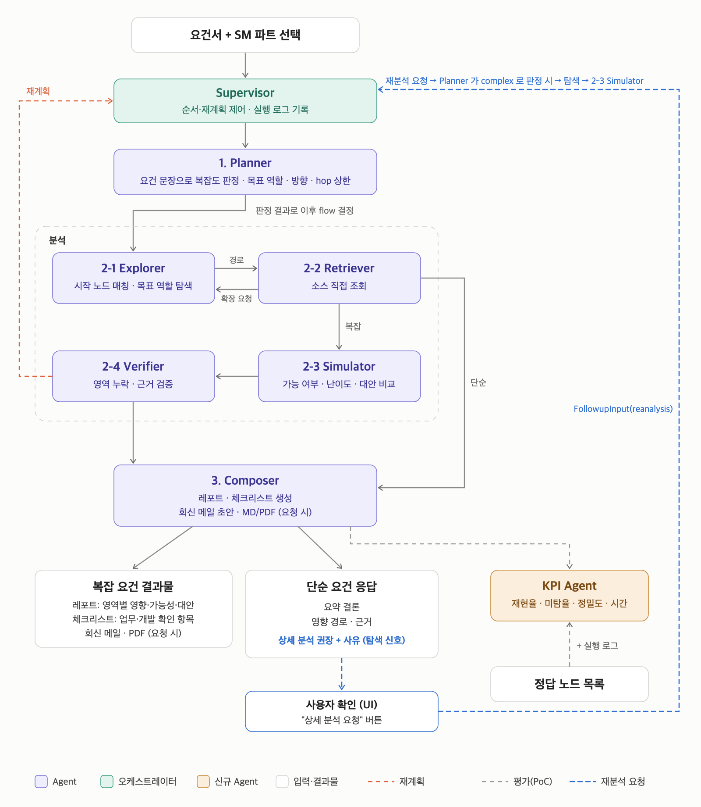
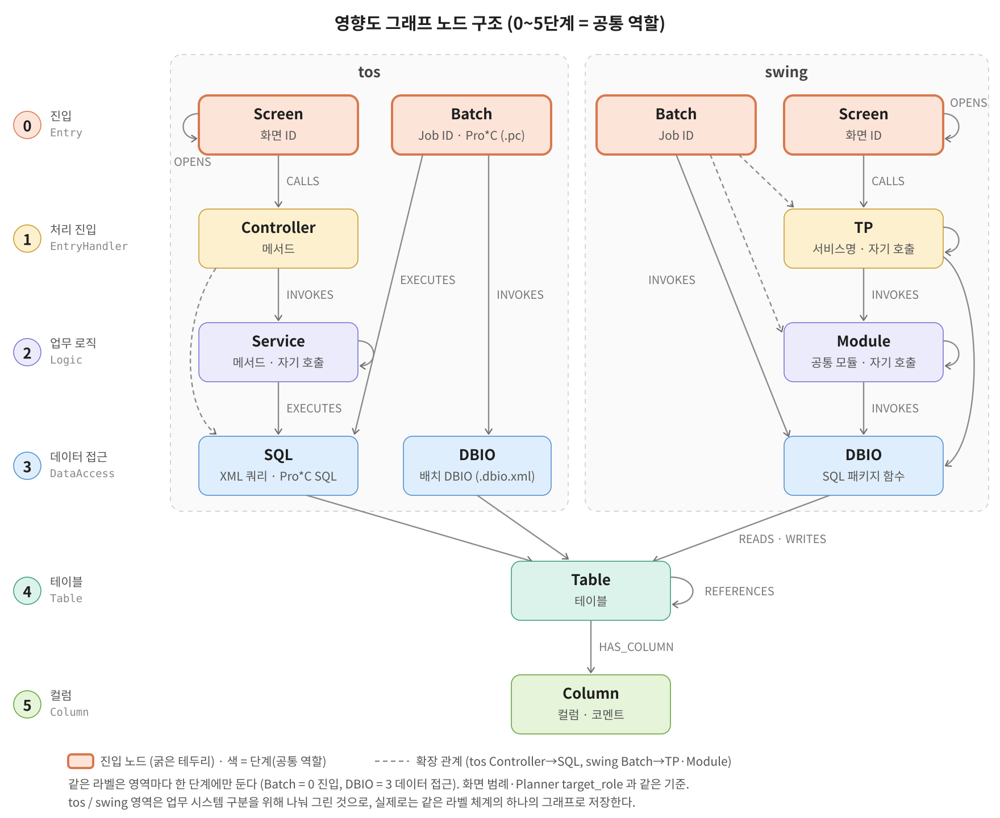

# Agent 설계서 (에이전트 단위)

> 담당: **Supervisor · 1 Planner · 2-1 Explorer · 2-2 Retriever · UI** (본인) / 2-3 Simulator · 2-4 Verifier · 3 Composer · KPI Agent (파트너)
> 스키마·필드명은 가안이며 그래프 적재 범위·프롬프트가 확정되면 조정한다.

## 변경 이력

| 일자 | 버전 | 내용 |
|---|---|---|
| 2026-10-29 | v5 | to-be 설계: Planner 요건 문장 기준 판정, 사용자 상세 분석 요청(reanalysis) → complex → 2-3 Simulator, Planner 실행마다 tool 한도 새로 |
| 2026-11-02 | v6-2 | 파트너 요청 반영: 항목 분리·그래프 밖·조건부 변경 판정·재분석 입력("참고:" 줄)·`unresolved_items`. Explorer 공통코드 규칙·근거 없는 확장 상한·언급 기준 정렬. Few-shot 축소. 실행 로그(받은 입력 → 동작 → 근거 → 결과). 용어사전 코드 제거 |
| 2026-11-03 | v6-3 | 공통코드 규칙은 언급 표현만 봄(동의어 X), 컬럼 끝 이어 붙이기, 항목 분리 보완(change_type 이 다르면 나눔), 재탐색 요청 노드는 경로 상한에서 제외 |
| 2026-11-04 | v6-4 | Planner 언급 빠뜨리지 않기·대상 하나에 언급 하나(항목당 최대 5개), 요청 문장의 식별번호를 Term 언급으로 보정. Explorer 언급 검색 상한(`RULE_SEARCH_BUDGET`). LLM seed 고정(`LLM_SEED`) |
| 2026-11-04 | v6-5 | Explorer 경로 정리: 진입점 없이 시작한 경로 앞에 진입점 연결(파트너 요청), 쓰기 접근에서 끝난 경로를 쓰는 테이블까지 연결 |
| 2026-11-05 | - | 문서 현행화: 상세 분석 요청 결정 사항(1-1), 파트너와 주고받은 요청(5-1~5-3) 정리. KPI 지표명을 KPI 설계서 v0.7 기준으로 |

## 0. 한눈에 보기



- 흐름: 요건서 + SM 파트 → Supervisor → 1 Planner(복잡도·탐색 명세) → 2-1 Explorer ⇄ 2-2 Retriever(경로 / 확장 요청) → 단순은 3 Composer, 복잡은 2-3 Simulator → 2-4 Verifier(보완 필요 시 재계획) → 3 Composer.
- KPI Agent (점선, 평가 PoC): 분석 흐름의 단계가 아니라 **별개로 측정**한다. Composer 이후 실행 결과·실행 로그를 정답 노드 목록(`AnswerKey`)과 비교해 핵심 지표([변경] 노드 정밀도 · [변경] 재현율 · 노드 탐지율)와 보조·판정·성능 지표를 내고 ([SE_kpi-agent-design.md](SE_kpi-agent-design.md)), 결과는 Composer 에 전달하지 않는다 (`agents/supervisor.py`: `… → COMPOSER → KPI → END`).
- 후속 입력(현업 답변·개발 의견·조회 결과)은 START 에서 바로 Composer 로, 변경 분석·재분석 요청은 Planner 로 간다. 단순 응답의 상세 분석 권장을 사용자가 확인하면 재분석 요청(파란 점선)으로 Planner 가 complex 로 판정해 2-3 Simulator 까지 간다.

```
UserInput (요청 문장 · SM 선택 · 확정 매핑)
  └ Supervisor (LangGraph) ──────────────────── 실행 로그(시간·tool·토큰) 기록, checkpointer 로 세션 보관
      1 Planner      LLM  요건 → 탐색 명세 (항목·언급 표현·변경 유형 → 목표 역할·방향·hop 상한)
      2-1 Explorer   규칙+ReAct 언급 표현 → 시작 노드 → 목표 역할까지 경로 ┐ 재탐색 ≤ 3회
      2-2 Retriever  규칙+ReAct 경로 노드 원문·정의서 → 근거 / 재탐색 요청  ┘ tool ≤ 20회
      2-3 Simulator  (복잡) 영역별 영향·가능성·난이도·대안
      2-4 Verifier   (복잡) 영역 누락·근거 검증 ─ 보완 필요 → Planner (재계획 ≤ 2회)
      3 Composer     단순 응답(+ 상세 분석 권장·사유) / 레포트·체크리스트·회신 메일
        └ 사용자 확인(UI "상세 분석 요청") → FollowupInput(reanalysis) → Supervisor → 1 Planner 가 complex 로 판정 → 탐색 → 2-3 Simulator
      KPI Agent      정답 노드 대비 평가 (PoC)
```

| 에이전트 | LLM | 입력 (AgentState) | 출력 | 구현 |
|---|---|---|---|---|
| Supervisor | - | UserInput | AgentState 전체 | `agents/supervisor.py` |
| Planner | gpt-6.1-sol | user_input, followups, replan_feedback | `PlannerOutput` | `agents/planner.py`, `prompts/planner.md`, `rules.py` |
| Explorer | gpt-6.1-sol (ReAct 보완) | planner.items, retriever.reexplore_request | `ExplorerOutput` | `agents/explorer.py`, `tools/graph.py` |
| Retriever | gpt-6.1-sol (ReAct 보완) | explorer.paths, planner.items | `RetrieverOutput` | `agents/retriever.py`, `tools/source.py` |
| Simulator | (파트너) | explorer, retriever | `SimulationOutput` | `agents/simulator.py` |
| Verifier | (파트너) | simulation | `VerifierOutput` | `agents/verifier.py` |
| Composer | (파트너) | 전체 | `ComposerOutput` | `agents/composer.py` |
| KPI Agent | - | 전체 + 정답 경로 | `KpiOutput` | `agents/kpi.py` |

### 0-1. 설계 기술 반영 (상세 설계서 "핵심 에이전트 기술 스택" 중 담당 범위)

| 구분 | 기술 | 반영 위치 |
|---|---|---|
| 페르소나 | 시스템 공통(역할·목표·톤·제약) + 에이전트별 페르소나 표 | `prompts/_common.md` (BaseAgent 가 모든 프롬프트 앞에 붙임), `prompts/{planner,explorer,retriever}.md` |
| Agent Framework | LangGraph: Supervisor = 진입 라우팅 + 노드 뒤 조건부 엣지 함수, MemorySaver checkpointer | `agents/supervisor.py` (`Supervisor.followup`) |
| Planner | Few-shot (Brown et al. 2020): 판정 규칙 나열 대신 형식 예시 1개(전체 JSON) + 경계 사례 5개(요청 → 판정·근거·항목 유형) | `prompts/planner.md` |
| Planner·Supervisor | Reflexion (Shinn et al. 2023): Verifier 사유를 `replan_feedback` 에 누적, 재계획 시 이전 탐색 명세 + 누적 사유를 함께 전달 | `supervisor._verifier_node`, `planner.user_message` |
| Explorer·Retriever | ReAct (Yao et al. 2023): 규칙 단계 결과를 Observation 으로 주고 Thought → Action → Observation 반복, 예시 궤적 1개 | `agents/react.py`, `explorer._react`, `retriever._react`, `ExplorerOutput/RetrieverOutput.react_trace` |
| Output Parsing | Structured Output (Pydantic): `PlannerDraft`, `ExplorerDecision`, `RetrieverDecision` | 각 agent 모듈 |

- 규칙 단계는 그대로 두고 ReAct 는 **빠진 곳 보완**만 한다 (매칭 실패·목표 미도달·잘린 원문·경로 밖 연결). LLM 키가 없거나 `REACT=0` 이면 규칙 단계만.
- Explorer ReAct 는 규칙 결과의 **점검 신호**가 있을 때만 시작하고(최대 8단계), tool 한도 중 5회(`RESERVED_FOR_RETRIEVER`)를 Retriever 몫으로 남긴다. Retriever ReAct(최대 6단계)는 탐색 범위 안 노드만 `read_source`(다시 읽으면 이어서), 범위 밖·경로에 없는 컬럼은 `request_reexplore`(`next_target`)로만.
- ReAct 단계의 LLM 호출이 실패하면(API 오류·응답 검증 실패) 그때까지의 단계만 남기고 규칙 결과로 진행한다.
- 응답 편차를 줄이려고 seed 를 고정한다 (`LLM_SEED`, 기본 7, 빈 값이면 끔). 이 모델은 temperature 를 기본값만 받아 고정하지 않는다. seed 를 받지 않는 모델이면 한 번 오류 난 뒤 seed 없이 부른다 (`llm.py`).
- tool 한도 배분 상수는 `rules.py` 한 곳(`RESERVED_FOR_RETRIEVER`, `MIN_CALLS_FOR_REEXPLORE`, `*_MAX_REACT_STEPS`), 남은 호출 계산은 `AgentState.tools_left()` 하나.
- 후속 입력: 답변·의견·조회 결과 → Composer, 변경 분석·재분석 → Planner. 최근 `MEMORY_WINDOW_N` 개만 유지.
- 범위 밖: RAG(벡터 DB)는 쓰지 않기로 함, Monitoring(Langfuse/LangSmith) 미확정, Simulator·Verifier·Composer 프롬프트 기법은 파트너 담당.

상수 (`schemas/schemas.json#/constants`): `MAX_EXPLORE_LOOP` 3, `MAX_REPLAN` 2, `MAX_TOOL_CALLS` 20, `MAX_HOPS_FORWARD` 5, `MAX_HOPS_BIDIRECTIONAL` 10, `MEMORY_WINDOW_N` 5.

---

## 1. Supervisor

**역할**: 순서·분기·재계획 제어. 분석 판단은 하지 않는다 (LLM 미사용, LangGraph 조건부 엣지).

**입력**: `UserInput { request_text, sm_part(product|marketing), output_options, confirmed_nodes[{phrase, node_id}] }`

**처리**
1. Planner 실행 → `confirmed_nodes` 를 같은 표현의 `Mention.confirmed_node` 에 반영 (사용자가 확정한 매핑 우선).
2. Planner 가 탐색 항목을 하나도 만들지 않으면(분석 대상 없음, 예: 업무와 무관한 질문) 탐색·시뮬레이션 없이 Composer 로 간다.
3. plan 에 Explorer 가 있으면 Explorer ⇄ Retriever 루프
   - Planner 실행(첫 분석·Verifier 재계획·사용자 재분석)마다 새로 시작 (`state.explorer = state.retriever = None`, 탐색 루프 수·**tool 호출 한도도 새로**). 재탐색 라운드는 이전 경로·근거를 이어받는다
   - Retriever 의 `reexplore_request` 가 없거나, `MAX_EXPLORE_LOOP` 에 닿거나, 남은 tool 호출이 `MIN_CALLS_FOR_REEXPLORE`(2: Explorer 탐색 1 + Retriever 새 노드 읽기 1) 미만이면 종료
4. `simple` → Composer (단순 응답 + 상세 분석 권장·사유) / `complex` → Simulator → Verifier → `needs_supplement` 면 `replan_feedback` 누적 후 Planner 로 (`MAX_REPLAN` 까지)
   - **사용자 상세 분석 요청**: 단순 응답의 권장을 사용자가 확인하면 `FollowupInput(type=reanalysis)` → START 에서 Planner 로 → Planner 가 complex 로 판정 → 탐색부터 다시 → 2-3 Simulator (아래 1-1). Supervisor 는 복잡도를 바꾸지 않는다
5. Composer → KPI Agent (평가 PoC, 결과는 Composer 에 전달하지 않음)
6. 에이전트마다 `AgentRunRecord { agent, latency_ms, tool_calls, input_tokens, output_tokens }` 기록

**한도·예외**: tool 호출은 에이전트 출력의 `tool_call_count` 를 `state.tool_call_count` 에 누적하고, 남은 호출은 `state.tools_left()` 로만 계산한다. `analyze(user_input, until="retriever")` 로 지정 단계까지만 실행 가능 (담당 범위 평가용).

### 1-1. 상세 분석 요청 (reanalysis) 결정 사항

파트너와 정한 규칙 (2026-10-29 · 11-02 · 11-03 협의, 파트너 쪽 상세는 [SE_agent_design.md](SE_agent_design.md) Composer · Simulator).

1. 복잡도는 Planner 만 정한다. 요건 문장에서 확인되는 것만으로 판정하고, 재분석도 Planner 가 다시 판정한다.
2. 단순 응답의 상세 분석 권장은 **강한 신호만** 권장(`detail_analysis_reasons`), 약한 신호는 참고 신호(`detail_analysis_notes`, 권장 안 함). 사유 문장에는 노드 ID 를 그대로 넣는다.
3. 사용자가 권장을 확인하면 `FollowupInput(type=reanalysis, content=권장 사유 줄 + "참고: " 참고 신호 줄)` → Planner 가 complex 로 판정 (`apply_reanalysis`). 사유 줄은 항목·언급 표현에, "참고: " 줄은 언급 표현(동의어)·확인 대상에 반영 (`prompts/planner.md` 7장).
4. 신규 후보·그래프 밖 신호는 문구가 아니라 `ExplorerOutput.unresolved_items[].kind`(`new_candidate` · `out_of_graph`)로 가른다 (Composer `unresolved_signals`).
5. 공용 데이터(`data/`)는 바꾸지 않는다.

---

## 2. Planner (1)

**역할**: 요청을 구조화하고, Explorer 가 쓸 **탐색 명세**를 만든다. 그래프를 모르는 상태에서 판단하므로 **노드 ID 를 정하지 않고 "무엇을 말했는지"만** 넘긴다.

**입력**: 요청 문장, SM 선택, 후속 입력, 재계획 피드백

**처리**
1. LLM(`gpt-6.1-sol`, OpenAI Structured Outputs)이 `PlannerDraft` 를 채운다: 구조화 요청, 복잡도·근거, 요건 항목(문장·`change_type`·언급 표현·그래프 밖 영역), 공통 제외 여부.
   - **요건 문장에서 확인되는 것만으로 판정** (1-1 #1): 탐색해야 알 수 있는 사실(공통 사용 여부·영향 범위·난이도)은 쓰지 않는다. `complexity_reason` 에 근거가 된 요건 표현을 큰따옴표로 인용
   - **영역 중립**: 프롬프트 0장에 SM 파트별 처리 구조·조건 위치·자주 나오는 요건(마케팅 tos / 상품 swing)을 나란히 두고, change_type 표에 두 영역 예를 함께 둔다
   - **Few-shot**: 형식 예시 1개(여러 영역 + 외부 전송, 전체 JSON) + 경계 사례 5개(같은 종류 고정 문구 simple · 결과 해석 운영 문의 simple · 오동작 운영 문의 complex · 구조 질의 simple · 조건부 변경 complex). 14,332자 → 8,718자
   - **조건부 변경**: 하나로 고정된 값을 구분·조건마다 다른 값으로 쓰게 바꾸면 complex (구분 판별 위치와 구분별 값 위치가 함께 바뀜), 화면 선택에 따라 고정 문구 하나를 보이고 숨기기만 하면 simple
   - **항목 분리**: 바뀌는 위치의 종류나 고르게 될 change_type 이 다를 때만 나눈다 (같은 화면 문구 두 곳은 한 항목). 구조 변경 유형(data_add·column_spec_change·query_field_add·interface_field_add)은 저장·조회·연계 항목 자체가 바뀔 때만
   - **언급 표현**: 시스템의 한 대상을 가리킬 만큼 구체적으로 ("상세"·"가입 처리" 같은 일반어만 따로 쓰지 않음). 조건부 변경이면 문구 Column 언급 동의어에 "공통코드"·"코드값" 계열. `out_of_graph` 에는 소스 밖 시스템·채널만 (업무 절차·정책은 open_items)
   - **빠뜨리지 않기 · 대상 하나에 언급 하나** (v6-4): 요건이 가리키는 화면·기능·데이터·배치, 바뀌는 값을 담는 항목(주기·기간·여부·코드·사유), 상품명·식별번호는 반드시 언급으로 남긴다. 항목당 언급은 서로 다른 대상만 최대 5개, 중요한 대상부터 (Explorer 가 앞 언급부터 검색). 같은 대상의 다른 표현은 `synonyms`, 구체 값("30분 → 5분")은 그 값을 담는 항목의 `meaning` 으로
   - 복잡도 기준 (Few-shot + 요약): 요건 문장에 여러 영역의 변경이 드러남·신규 항목·지금 화면에 없는 다른 화면·업무 데이터를 새로 보여 달라 → complex. **대상 개수가 아니라 바뀌는 위치의 종류**로 판단 (같은 종류의 고정 값을 여러 개 바꾸는 것은 위치 종류 하나). 운영 문의는 문장 끝맺음("알려 주세요")이 아니라 **문의 대상이 정상 동작의 결과인지(결과 해석 → simple), 기대와 다른 동작인지(안 보임·안 됨 → complex)** 로 가른다. 애매하면 complex
2. 코드가 판단 기준표로 나머지를 채운다 (LLM 판단 일관성 확보)
   - **복잡도 코드 규칙** (`apply_reanalysis`): 마지막 후속 입력이 `reanalysis` 면 LLM 판정과 관계없이 complex, `plan` 에 Simulator·Verifier, 사유 앞에 "사용자 상세 분석 요청: <권장 사유>". 이전 판정이 complex 인 Verifier 재계획 라운드도 complex 유지 ("재계획 (복잡 흐름 유지) n차"). 재분석이면 프롬프트 7장대로 권장 사유를 항목·언급 표현에 반영
   - **식별번호 언급 보정** (`ensure_identifier_mentions`, v6-4): 요청 문장의 시스템 ID 형태(영문 2~8자 + 숫자 4자리 이상, 예: 상품코드 `NA00004184` · 화면 ID `ZCMBSS0100010`)가 어떤 언급의 표현·동의어에도 따로 없으면, 그 번호가 든 항목(없으면 첫 항목)에 Term 언급으로 더한다. 긴 표현 안에만 있으면 번호로 검색되지 않기 때문 (v6-3 M-2 상품코드 누락). 영문 1자 + 숫자(사번·캠페인 번호 같은 데이터 값)는 그래프에 없어 넣지 않는다
   - 항목별 `target_role`·`direction`·`hop_cap` ← `rules.CHANGE_TYPE_RULES`
   - `domains` ← `rules.SM_PART_DOMAINS` (marketing → tos, product → swing)
   - `plan` ← 복잡도 (simple: explorer·retriever / complex: + simulator·verifier)

**요건 유형 → 목표 역할**

| change_type | 의미 | 목표 역할 | 방향 | hop |
|---|---|---|---|---|
| `screen_change` | 화면 입력·표시 변경 | EntryHandler | forward | 5 |
| `logic_change` | 검증·처리 로직 변경 | Logic | forward | 5 |
| `query_field_add` | 조회 결과 항목 추가 | DataAccess | forward | 5 |
| `data_add` | 저장 데이터 추가 | Table | forward_then_reverse | 10 |
| `column_spec_change` | 컬럼 길이·타입 변경 | Entry | reverse | 5 |
| `batch_change` | 배치 처리 변경 | DataAccess | forward | 5 |
| `interface_field_add` | 연계 항목 추가 | Entry | reverse (+그래프 밖) | 5 |
| `ops_cause` | 운영 이슈 원인 확인 (추가) | Table | forward | 5 |
| `structure_query` | 구조·데이터 위치 질의 (추가) | Column | forward | 5 |

**언급 표현 (`Mention`)**: `kind`(Screen/Batch/Function/Table/Column/Interface/Term), `phrase`(요건 표현 그대로), `maybe_new`, `synonyms`(현업·시스템 표현, 반대 개념 포함), `meaning`, `area`, `confirmed_node`(Supervisor 가 채움)

**출력 `PlannerOutput`**: `structured_request`, `complexity`, `complexity_reason`, `domains`, `items[ExploreItem]`, `exclude{is_common}`, `plan`

```json
{"item_id": 1, "text": "캠페인 등록 화면에 비마케팅 여부 입력 추가", "change_type": "data_add",
 "mentions": [{"kind": "Screen", "phrase": "캠페인 등록 화면", "synonyms": ["캠페인 등록"]},
              {"kind": "Column", "phrase": "비마케팅 여부", "maybe_new": true, "synonyms": ["마케팅 여부", "광고 여부"],
               "meaning": "메시지가 마케팅 목적인지 구분하는 Y/N 값"}],
 "target_role": "Table", "direction": "forward_then_reverse", "hop_cap": 10, "out_of_graph": []}
```

**한도·예외**: `OPENAI_API_KEY` 가 없으면 즉시 오류 (CLI `--plan` 으로 준비한 PlannerOutput 을 넣어 Explorer 이후만 확인 가능). 프롬프트 예시는 평가 시나리오와 무관한 가상 요건만 쓴다 (평가 오염 방지).

---

## 3. Explorer (2-1)

**역할**: 탐색 명세의 언급 표현을 그래프 노드로 매칭하고, 목표 역할까지 경로를 찾는다. 요건 유형 판단은 하지 않는다. 규칙 단계 뒤 ReAct 보완 단계에서 LLM 사용 (매칭 실패·목표 미도달·진입점·언급 값의 컬럼·공통코드 점검).

**ReAct 시작 조건 (점검 신호)**: 규칙 결과에서 코드가 신호를 계산하고, 신호가 없으면 ReAct 를 생략한다. 신호는 입력 끝 `[점검 신호]` 로 LLM 에 준다.

| 신호 | 조건 |
|---|---|
| ① 매칭 실패 | 항목에 노드를 못 찾은 언급 표현 |
| ② 목표 미도달 | 항목 경로가 목표 역할에 닿지 않음 |
| ④ 진입점 없음 | 항목 경로가 모두 Entry(화면·배치) 아닌 노드에서 시작 |
| ⑤ 값의 컬럼 없음 | 항목에 Column·Term 언급이 있는데 경로에 Column 이 없음 |
| ⑥ 공통 제외 | 공통이라 확장하지 않은 노드가 있음 |

**입력**: `planner.items`, `planner.domains`, `planner.exclude`, 재탐색이면 `retriever.reexplore_request` + 이전 `explorer`

**tool**: `search_graph_nodes(terms, domains, labels, top_k)`, `traverse_graph(start_ids, direction, target_role, hop_cap, exclude_common, focus_ids, writes_only)`, `get_node_detail(node_id)`

### 3-1. 그래프 모델



- 그림 = 0 진입 ~ 5 컬럼 단계의 기본 구조 (화면 이동 OPENS 포함). 그림에 없는 확장 관계: tos Controller -EXECUTES→ SQL(★ 매퍼 직접 호출), swing Batch -INVOKES→ Module·TP(★ 배치의 모듈·서비스 재사용). Table -REFERENCES→ Table 은 DDL 에 FOREIGN KEY 가 있는 tos 에만 있다. 전체 패턴은 [mock_data.md](mock_data.md).
- 노드 = 영역별 라벨 + **공통 역할 라벨** (`:Node:Controller:EntryHandler`, 속성 `role`)

| 역할 | tos | swing |
|---|---|---|
| Entry | Screen, Batch | Screen, Batch |
| EntryHandler | Controller | TP |
| Logic | Service | Module |
| DataAccess | SQL(XML·Pro*C·Job SQL), DBIO | DBIO |
| Table / Column | Table / Column | Table / Column |

- 엣지: CALLS, OPENS(화면→화면), INVOKES, EXECUTES, READS, WRITES(속성 `columns`), REFERENCES, HAS_COLUMN
- 노드 속성 `is_common`(공통 유틸·모듈·코드), `search_text`(노드명·설명·컬럼 코멘트)

### 3-2. 시작 노드 매칭
1. `confirmed_node` 가 있으면 그대로 (`match_source=confirmed`)
2. 없으면 `search_graph_nodes` (언급마다 1회, 같은 검색은 재사용). 규칙 단계의 언급 검색은 모두 `RULE_SEARCH_BUDGET`(12)회까지로, 항목마다 `max(2, 12 ÷ 항목 수)` 회를 앞 언급부터 쓴다. 넘는 언급은 검색을 생략하고 `unresolved_items(kind=tool_limit)` 로 남긴다 (언급이 많아도 탐색·Retriever 몫을 남기기 위함, v6-4). Neo4j full-text 인덱스 `node_search`(`search_text`, cjk 분석기 = 한글 2글자 단위 부분 일치)로 후보를 모으고 점수를 다시 매긴다.
   - 표현 점수 = 통째로 포함 1, 아니면 2글자 단위 일치 비율
   - 가중치: 요건 원문 표현 1, 동의어 2글자 0.8·3글자 0.9·4글자 이상 1 / 다른 표현이 함께 통째로 맞으면 +0.05씩
   - 채택: 0.5 이상 · 1등의 80% 이상 · 언급마다 최대 3개. 검색 대상 라벨은 `kind` 로 제한
3. 못 찾으면 `unresolved` 에 "매칭 실패" (`maybe_new` 면 "신규 후보"). 같은 내용을 `unresolved_items[{item_id, kind(new_candidate|out_of_graph|unmatched|tool_limit), text}]` 로도 넘긴다
4. **공통코드**: 값(Column) 언급 **표현 자체**가 문구·사유·코드값·설정값을 말하면 공통코드 테이블(`search_graph_nodes(["공통코드"], labels=["Table"])`)을 시작 노드로 더하고, 그 테이블을 읽는 처리까지 역방향(EntryHandler, hop 3)으로 확인한다. 화면이 공통코드를 새로 쓰는 요건은 그래프에 엣지가 없어 탐색으로 닿지 않기 때문. 직접 찾은 공통 데이터라 공통 제외를 적용하지 않는다. 동의어는 보지 않는다 (v6-2 에서 동의어 "공통코드" 로 단순 요건 13건에서 켜짐 → v6-3 에서 SC-003·SC-006 2건만)

### 3-3. 탐색 규칙

| 구분 | 규칙 |
|---|---|
| forward | 목표 역할보다 진입 쪽 시작 노드에서 정방향 |
| reverse | 목표 역할보다 DB 쪽 시작 노드에서 역방향. 언급으로 찾은 진입점(예: 연계 배치)은 언급 컬럼까지 정방향으로도 확인 |
| forward_then_reverse | 정방향으로 목표(수정 대상)를 찾고, 언급 컬럼(없으면 도달·언급 테이블)에서 Entry 까지 역방향. 테이블에서 출발하면 WRITES 만 |
| 멈춤 | 목표 역할 도달(`target_reached`). 목표를 건너뛰면 건너뛴 노드에서(`nearest_role`, 예: tos Batch→SQL 은 Logic 없음) |
| hop | 역할이 바뀌는 단계만 센다 (자기 호출·화면→화면 제외). 상한 도달은 `hop_cap` + `frontier` |
| 순환 | 경로 안 방문 노드로 막음. 경로가 다르면 따로 기록 (최대 300) |
| 화면 이동 | OPENS 는 시작 화면에서 한 단계만 |
| 공통 제외 | `exclude.is_common` 이면 공통 노드 확장 안 함 → `excluded_common` (시작 노드는 예외) |
| 컬럼 | 목표가 Column 일 때만 확장: 언급 컬럼 → 접근 엣지 `columns` → 시작 테이블이면 전체 |
| 역방향 컬럼 필터 | Column → Table → SQL/DBIO 는 그 컬럼을 읽거나 쓰는 엣지만 |
| 그래프 밖 | `out_of_graph` 는 탐색 안 함 → `unresolved` |

### 3-4. 경로 정리 (뒤 단계 전달 순서)

규칙 단계·ReAct·재탐색 뒤마다 `_arrange_paths` 로 정리한다. Retriever 읽기 상한(80)·Simulator 입력 경로 상한(40)은 앞쪽 경로부터 쓰므로 **순서가 곧 전달 우선순위**다.

0. **컬럼 끝 이어 붙이기**: 데이터 접근·테이블에서 끝난 경로가 언급으로 매칭된 컬럼의 테이블을 읽거나 쓰면 그 테이블·컬럼까지 잇는다 (목표가 DataAccess 인 항목은 정답 경로 끝의 컬럼까지 가지 않음, v6-3 M-4 Simulator 전달 0 → 1)
   - **쓰기 테이블 연결** (`_extend_writes_to_tables`, v6-5): 데이터 접근에서 끝난 경로가 테이블 하나에만 쓰면(WRITES) 그 테이블까지 잇는다. 목표가 Logic·DataAccess 인 항목도 갱신되는 데이터는 영향 범위라서 (읽기만 하는 접근은 잇지 않음)
1. 같은 처리에서 마지막 컬럼만 다른 경로(컬럼까지 탐색할 때 컬럼마다 갈라짐)는 시작 노드이거나 요건 언급이 이름·코멘트에 통째로 들어 있는 컬럼만 남기고, 없으면 테이블까지 한 경로로 합친다 (노드 목록·엣지의 접근 컬럼은 유지)
2. 같은 항목의 다른 경로 안에 그대로 들어 있는 짧은 경로·중복 경로는 뺀다
   - **진입점 연결** (`_extend_to_entries`, v6-5, 파트너 요청): 진입점 없이 처리(EntryHandler·Logic·DataAccess)에서 시작한 경로 앞에, 그 처리를 부르는(`CALLS`·`INVOKES`·`EXECUTES` 역방향) 가장 가까운 화면·배치까지의 노드를 붙인다 (최대 4단계 `ENTRY_HOPS`, 공통 노드는 거치지 않음, 같은 거리면 ID 순). 공통 노드·공통코드 경로는 부르는 곳이 많아 붙이지 않는다. Simulator 영역 배정·진입점 수 신호가 경로 첫 노드를 쓰기 때문 (예: `MOD:CombDcBatch.calcDcAmt` ← `BAT:ZCMBBB0100010`). 앞만 붙이고 경로 수는 바꾸지 않으며, 같아진 경로는 하나만 남긴다
3. **근거 없는 확장 상한**: 매칭 근거 없이 추가된 출발 노드(ReAct 가 고른 노드, 점수 없음)에서 요건 언급 노드를 하나도 지나지 않는 경로는 출발 노드당 2개(`UNSUPPORTED_PER_START`)까지. Retriever 가 원문 근거로 재탐색을 요청한 노드는 제외 (v6-1 H-1 오탐 111개가 ReAct 가 고른 화면에서 모든 호출로 퍼진 경로)
4. 항목마다 정렬 (언급 노드를 많이 지남 → 보완 경로 → 진입점에서 시작 → 목표 도달 → 긴 경로) 후 항목을 번갈아 배치

### 3-5. 재탐색
Retriever 요청을 받아 이전 결과에 이어서 탐색한다. `continue` 는 hop 상한으로 끊긴 경로에 새 경로를 이어 붙여 하나로 만든다. 요청 노드가 Column 이면 그 컬럼을 쓰는 엣지만 따라간다(`focus_ids`). 재탐색 라운드는 Retriever 가 새 노드를 읽을 1회를 남긴다.

**출력 `ExplorerOutput`**: `start_nodes[{item_id, node_id, matched_keyword, match_source, score, reason}]`, `nodes`, `edges`, `paths[{item_id, nodes(진입→DB), direction, reached_role, stop_reason}]`, `item_results[{reached, hops_used, frontier, unmatched_mentions}]`, `excluded_common`, `unresolved`, `unresolved_items`, `hops_used`, `tool_call_count`

**실행 로그** (`trace`): 언급별 후보 채택·탈락(점수), 시작 노드 분류(목표보다 진입 쪽·목표·DB 쪽), 탐색 경로, 점검 신호, ReAct Thought·Action·Observation, 경로 정리(컬럼 이어 붙이기·상한 제외 수)

**한도·예외**: tool 호출이 남은 한도를 넘으면 이후 탐색을 생략하고 `unresolved` 에 기록. 저장소는 Neo4j(기본) 또는 `GRAPH_BACKEND=csv`(개발·테스트).

---

## 4. Retriever (2-2)

**역할**: 경로 노드의 소스·화면·인터페이스 정의서 **원문을 직접 읽어** 근거로 Simulator 에 넘긴다. 벡터 검색 없음. 규칙 단계 뒤 ReAct 보완 단계에서 LLM 사용 (잘린 원문 더 읽기, 경로 밖 연결은 재탐색 요청).

**입력**: `explorer.start_nodes`, `explorer.paths`, `explorer.item_results`, `planner.items`

**tool**: `read_source(node_ids, context_lines)`

**처리**
1. 시작 노드 + 경로 노드를 한 번에 읽는다 (최대 80개, 초과분은 근거 없음으로). 재탐색 라운드는 이전 라운드 근거를 이어받고 **근거가 없는 새 노드만** 읽는다
   - 위치: `SOURCE_ROOT_<DOMAIN>` / `source_file` 의 `source_line` 부터 노드 범위
   - Screen 은 연결 js, Batch 는 실행 프로그램(tos `.pc`, swing `program/*.pgm`)을 이어 붙임. Column 은 DDL 줄 + 코멘트
   - 노드 `interfaces` 가 있으면 정의서(`DOCS_ROOT_<DOMAIN>/interface`, 파일명 = ID 또는 파일 안 `INTERFACE <ID> … END INTERFACE` 블록)도 (`source_kind=interface_spec`)
2. `Evidence { node_id, file_path, symbol, location(L시작-끝), summary, source_kind, domain, content(원문) }`. 같은 노드·파일·종류는 가장 넓은 범위 하나로 합친다
3. ReAct 보완 (최대 6단계)
   - 입력: 탐색 명세, Explorer 경로, 근거별 앞 10줄, `[경로 밖 연결]`, `[경로 테이블의 컬럼]`(경로에 없는 컬럼 + 코멘트, 원문 SQL·프로그램·화면에 이름이 나오면 ★)
   - `read_source` 다시 읽기는 **이미 보여 준 줄 다음부터** 이어서 (노드 1개면 6,000자, 여러 개면 2,400자를 나눠 씀). `context_lines` 로 범위가 앞으로 넓어지면 새로 붙은 줄부터. 끝까지 본 노드는 tool 을 부르지 않고 오류 Observation
   - 원문이 요건 값을 다루는 컬럼(다른 이름·반대 개념 포함)이 경로에 없으면 그 `COL:` 노드로 `request_reexplore` (reverse → Entry). 남은 호출이 2회 미만이면 요청 거부
   - **핵심 근거**: `finish` 의 `key_evidence[{node_id, quote, note}]` — 원문 코드 한 줄을 그대로 인용하면 그 줄 앞 3 · 뒤 8줄을 잘라 `summary="[핵심] note"` 근거로 근거 목록 맨 앞에 둔다 (붙은 파일이면 그 파일 기준 줄 번호). 원문에 없는 인용은 버린다. 뒤 단계는 근거마다 앞부분만 보므로 깊은 곳의 근거를 전달하기 위함
   - 프롬프트에 영역별 노드 유형 표(tos Controller·Service·SQL / swing TP·Module·DBIO)와 영역마다 예시 1개
4. 재탐색 요청 (이미 요청한 노드 조합은 라운드가 바뀌어도 다시 요청하지 않음)

| mode | 조건 | 요청 |
|---|---|---|
| continue | 항목에 `frontier`(hop 상한) | frontier 에서 같은 목표로 이어서 |
| reverse | 정방향 항목인데 시작 노드가 모두 목표보다 DB 쪽이라 경로 없음 | 그 노드에서 Entry 까지 |
| next_target | (ReAct) 원문에서 탐색 범위 밖 연결을 발견 (`[경로 밖 연결]` 의 노드) | 지정한 목표 역할·방향까지 |

**출력 `RetrieverOutput`**: `evidence`, `nodes_without_evidence`, `reexplore_request[{item_id, mode, node_ids, target_role, direction, reason}]`, `tool_call_count`, `react_trace`

**실행 로그** (`trace`): 읽은 노드별 파일·줄·종류, ReAct 단계, [핵심] 근거의 원문 인용과 버린 인용

---

## 5. 파트너 담당 (인터페이스만)

| 에이전트 | 받는 것 | 내는 것 |
|---|---|---|
| Simulator | `explorer.paths`(경로), `retriever.evidence[].content`(원문), `explorer.unresolved`(분석 범위 밖) | `SimulationOutput` 영역별 영향·가능성·난이도·대안, `unverified_segments` |
| Verifier | `simulation` | `VerifierOutput` pass / needs_supplement + `additional_scope` (→ Planner 재계획) |
| Composer | 전체 | `ComposerOutput` 단순 응답 / 레포트·체크리스트·회신 메일·PDF |
| KPI Agent | 전체 + 정답 노드(`eval/ground_truth/*.json`) | `KpiOutput` 핵심 [변경] 노드 정밀도·[변경] 재현율·노드 탐지율, 보조·판정 품질, 실행 로그 성능 ([SE_kpi-agent-design.md](SE_kpi-agent-design.md)) |

### 5-1. SE 반영 요청 (YJ → SE, v6-3 기준, 2026-11-03)

| # | 위치 | 내용 | 근거 (v6 E2E) |
|---|---|---|---|
| 1 | `agents/composer.py` `detail_reasons` | 신규 후보 · 그래프 밖 신호를 `explorer.unresolved` 문자열("신규 후보"·"그래프 밖" 문구 찾기) 대신 `explorer.unresolved_items[].kind` (`new_candidate` · `out_of_graph`) 로 판정 | 1-1 #4 의 SE 몫. 문자열 문구가 바뀌면 신호가 조용히 사라지는 문제 |
| 2 | `agents/kpi.py` | 노드 정밀도와 함께 **[변경] 노드 정밀도**(Simulator·Composer 가 [변경] 으로 표시한 노드 중 정답 비율) 기록 | KPI 오탐 중 [참조]·표시 없음 노드 비율 v6-1 97.8% · v6-2 98.9% · v6-3 95.7%. [변경] 정밀도 0.96 · 0.92 · 1.00 |
| 3 | `agents/kpi.py` · KPI 설계서 | 정답 노드가 1개뿐인 단순 요건의 정밀도 해석 기준 | SC-005 정밀도 0.02 · 0.02 · 0.03 (탐지율 1.00, [변경] 정밀도 1.00) |
| 4 | `agents/simulator.py` · `prompts/simulator.md` | 정답 수정 영역을 모두 "참조만"으로 판정하는 케이스 확인 | SC-002 · SC-004 [변경] 재현율 0.00 (세 실행 모두). SC-004 는 정답 경로가 모두 Simulator 입력에 있었음 (전달 1.00). 2026-11-05 KPI v0.7 부터 운영 문의(`input_type=ops_inquiry`)는 [변경] 재현율에서 제외 → 이 둘의 판정은 `change_tag_accuracy` 로 확인 |
| 5 | 〃 | [변경] 재현율 낮은 케이스 | M-2 0.17 · H-1 0.33 · M-4 0.50 (평균 0.64 → 0.60 → 0.65) |
| 6 | 〃 | 공통코드 경로(`CTL:CmmCdController.selectCdList` → `SQL:CmmCdMapper.selectCdList` → `TBL:TCP_CMM_CD`)가 이제 입력에 들어감 → 공통코드 데이터 등록을 TBL [변경](add/modify)으로 판정하는지 확인 | SC-003 [변경] 재현율 0.50 (정답 변경 노드 2개 중 1개) |
| 7 | 스키마 공유 | `ExplorerOutput.unresolved_items` 추가, `MatchSource` 에서 `glossary` 제거 | 머지 후 `tests/test_schema_sync.py` 로 확인 |

SE 처리 현황 (2026-11-03, SE):
- #1 반영: `composer.unresolved_signals` 가 `unresolved_items[].kind`(`new_candidate`·`out_of_graph`)로 가름. 종류가 없는 이전 저장 상태만 문구로
- #2 `change_node_precision` 추가 (측정만), #3 정답 노드 1개면 노드 정밀도 하한 미적용 (기록만) — [SE_kpi-agent-design.md](SE_kpi-agent-design.md) v0.4
- #4·#5·#6 반영: SE v3 에서 정답 변경 노드 44개 중 22개를 [변경] 으로 놓쳤고, 18개는 LLM 이 [참조] 로 판정 (입력 상한 탓 0개), 4개는 경로에 없음(상류). Simulator 입력에 `[요건 대상 노드]`(요건 언급과 매칭된 시작 노드, 판정 필수)를 추가하고, 프롬프트에 참조로 잘못 두기 쉬운 경우(데이터 등록·보정 — SC-002 `TCM_USER_AUTH`·SC-003 `TCP_CMM_CD`·M-2 `TB_PROD_RELN`, 처리 분기·검증 추가 — H-1 `joinComb`·M-2 `termProd`, 화면 전달·표시 — SC-004 화면)를 변경 기준으로 명시 ([SE_agent_design.md](SE_agent_design.md) 1장 입력 구성). 확인은 상류 고정 재실행 `scripts/SE/replay_run.py --from 20261103-v3`
- #7 반영된 상태 (`schemas.json` 에 `UnresolvedItem`, `tests/test_schema_sync.py` 통과)

### 5-2. YJ 반영 요청: Logic 시작 노드 경로의 진입점 역추적 (SE → YJ, 2026-11-03)

**현상**: 시작 노드가 Module(Logic)이고 목표 역할도 Logic 이면 `traverse_graph` 가 바로 `target_reached` 로 끝나, 그 노드 하나(또는 Module 끼리만 이어진) 경로가 된다. 이 노드를 누가 호출하는지(진입점 쪽 엣지)는 Explorer 결과(`paths`·`edges`)에 남지 않는다.

| 실행 | 진입 노드 없는 경로 | 예 |
|---|---|---|
| SE v1 (20261102-v1) H-2 | 4건 | `MOD:ProdScrbSvc.checkScrbAvail` (정답 노드) |
| SE v2 (20261103-v2) H-1 | 4건 | `MOD:ProdScrbSvc.checkAgeLimit` · `checkProdReln` · `checkScrbAvail`, `MOD:CombScrbSvc.validateCombMbr → … → MOD:CommCdSvc.getCdAttr` |
| SE v2 H-2 | 6건 | 위 3개, `MOD:CombDcBatch.calcDcAmt`, `MOD:ProdScrbSvc.checkAgeLimit → MOD:AgeCalcUtil.*` 2건 |

그래프에는 호출 쪽이 있다: `BAT:ZCMBBB0100010 -INVOKES-> MOD:CombDcBatch.calcDcAmt`, `TP:ProdScrbSvc.scrbProd · changeFeeProd -INVOKES-> MOD:ProdScrbSvc.checkScrbAvail -INVOKES-> checkAgeLimit · checkProdReln`. H-1 에서는 `BAT:ZCMBBB0100010` 이 같은 항목의 시작 노드였는데도 `calcDcAmt` 로 가는 엣지가 결과에 없었다.

**영향**
- Simulator 영역 배정: 영역은 경로의 진입 노드로 정하므로(SE_agent_design 1-1) 이 경로는 영역이 없다. 전에는 어느 영역 경로에도 들어가지 않아 결과·레포트·KPI 에서 기록 없이 빠졌다 (v1 H-2 `checkScrbAvail` 미탐의 원인).
- 진입점 기반 신호: 공유 노드(`rules.shared_nodes`, 진입점 2개 이상)와 Composer 진입점 수(`entry_points`)는 Explorer 경로 첫 노드가 Entry 인 것만 센다. 이 노드들의 진입점은 세지 않아 공유 노드 판정·난이도 보정·상세 분석 권장 신호가 약하게 나올 수 있다.

**SE 쪽 임시 대응 (반영됨)**: `simulator.assign_orphan_areas` 가 영역 없는 경로에 (1) Explorer 엣지의 호출 노드 영역 → (2) 그래프 역방향 호출 진입점(Screen·Batch, 4 hop) 영역 → (3) screen 순으로 영역을 정하고 분석 한계에 "영역 추정: …" 으로 남긴다. v2 H-1·H-2 기준 (3) 으로 떨어지는 경로는 0건 (`calcDcAmt` → batch). 영역만 보완하고 경로·진입점 신호는 바꾸지 않는다.

**요청**: 진입점(Entry) 없이 끝난 경로(시작 노드가 Logic·DataAccess 등이고 목표 역할에 바로 닿은 경우)는 진입점까지 역방향으로 이어 경로에 넣는다 (예: `BAT:ZCMBBB0100010 → MOD:CombDcBatch.calcDcAmt`). hop 상한·tool 한도 안에서, 진입점이 여러 개면 진입점별 경로로. 반영되면 Simulator 의 "영역 추정" 분석 한계가 0건이 되고 `assign_orphan_areas` 는 안전장치로만 남는다.

**확인**: SE `scripts/SE/run_scenarios.py` 로 H-1·H-2 실행 → `<case>.md` 분석 한계에 "영역 추정" 이 없는지, `summary.json` 의 KPI 탐지율 유지.

### 5-3. YJ 반영 요청: 정답 노드를 지나지 않는 경로 줄이기 (SE → YJ, 2026-11-03)

**현상**: KPI 노드 정밀도가 낮은 가장 큰 원인이 결과 경로 수다. SE v3 (20261103-v3) 기준 결과 경로 중 정답 노드를 하나도 지나지 않는 경로(무관 경로)가 많고, KPI 오탐 339개 중 143개(42%)가 이런 경로에만 있다. 경로 수는 Explorer 결과에서 정해지고, Simulator·Composer 는 경로를 그대로 쓴다 (Simulator 경로 제외는 v3 에서 0건, 아래).

| 케이스 | 결과 경로 | 무관 경로 | 무관 경로만의 오탐 / 오탐 |
|---|---|---|---|
| M-1 | 34 | 29 (85%) | 26 / 29 |
| M-4 | 23 | 19 (83%) | 17 / 22 |
| SC-006 | 10 | 8 (80%) | 10 / 12 |
| M-2 | 67 | 50 (75%) | 15 / 26 |
| H-2 | 26 | 18 (69%) | 16 / 21 |
| L-4 | 10 | 6 (60%) | 7 / 11 |
| M-3 | 45 | 18 (40%) | 20 / 34 |
| SC-003 · SC-004 · SC-001 · SC-002 · H-1 | 5 · 21 · 22 · 15 · 44 | 30~40% | 2/2 · 6/27 · 8/26 · 5/14 · 5/32 |
| L-1 · L-2 · L-3 · SC-005 | 52 · 3 · 3 · 27 | 4~33% | 5/41 · 0/1 · 0/3 · 1/38 |

결과 경로 = 복잡은 Simulator 영향 경로, 단순은 Composer 단순 응답 경로 (KPI `final_nodes` 와 같음). 무관 경로를 모두 빼면 16건 합산 노드 정밀도 0.135 → 0.213 (상한). 나머지 오탐은 정답 노드를 지나는 경로 위 곁가지 노드(DBIO·SQL·TP·Service)라 경로 수를 줄여도 남는다.

**SE 쪽 상황 (참고)**: Simulator 는 LLM 제외 제안을 가드로 거르는데, 무관 경로 170개 중 138개(81%)가 "목표 역할 도달 + 마지막 노드 근거 있음" 가드에 걸려 제안이 있어도 남는다. 이 가드는 탐지율(Critical 미탐 0) 보호용이라 SE 에서 먼저 완화하지 않는다. "[변경] 노드가 없는 경로 제외" 를 저장 결과에 적용해 보면 복잡 요건 정밀도 0.147 → 0.247 이지만 탐지율 1.00 → 0.90 (정답 4개 손실: `MOD:CombDcBatch.calcDcAmt`, `SQL:tbch1010.make_snd_tgt#2`, SC-003 `TBL:TCP_CMM_CD` · `SQL:CmmCdMapper.selectCdList`) 이라 Simulator 단에서 줄이는 것은 위험하다.

**요청**: 경로를 만드는 단계에서 요건과 무관한 분기를 줄인다. 예: 요건 언급 노드를 지나지 않는 경로의 상한을 단순 요건(3-4 근거 없는 확장 상한, 출발 노드당 2개)뿐 아니라 복잡 요건에도 적용할지, 화면의 모든 호출로 퍼지는 분기(M-1·M-4·M-2)를 언급 노드 기준으로 자를지 검토. 정답 경로 재현율(must_find)은 유지해야 한다.

**확인**: 위 표의 무관 경로 비율과 KPI 노드 정밀도, 탐지율 (같은 16건, `scripts/YJ/run_all.sh` 또는 SE `run_scenarios.py`). SE 구간 효과와 섞이지 않게 비교할 때는 `scripts/SE/replay_run.py --from <실행>` 으로 SE 구간만 다시 돌릴 수 있다.

---

## 6. 데이터·적재 (공통 기반)

- 그래프: `scripts/build_graph.py` (공통 파서 뼈대 `scripts/graph/common.py` 위의 영역별 파서 → 공통 검증 → `data/graph` → `--load` Neo4j). 노드 688 · 관계 850. 노드 ID 규칙 `<접두어>:<키>` ([mock_data.md](mock_data.md))
- swing 한글 이름·설명: `data/docs/swing/` 정의서(테이블·프로그램·화면·배치)에서 읽어 `search_text`·`is_common` 에 반영
- 적재 시 추가: 역할 라벨, `is_common`, `search_text`, full-text 인덱스 `node_search`(cjk)
- 용어사전(업무 용어 → 노드 매핑)은 쓰지 않는다. 평가 시나리오에 맞춘 매핑이 될 위험(평가 오염)이 있어 파일을 두지 않았고, 읽던 코드(`build_graph.py`·`graph/model.py`·`tools/graph.py`·`MatchSource.GLOSSARY`)도 2026-11-02 삭제했다 (그래프 결과 동일)

## 7. 스키마 변경 요약

| 모델 | 변경 |
|---|---|
| enums | `NodeRole`, `ChangeType`, `Direction`, `MentionKind`, `MatchSource`(confirmed·text, v6-2 에 glossary 제거), `StopReason`, `ReexploreMode` |
| `UserInput` | + `confirmed_nodes` |
| `PlannerOutput` | + `domains`, `items[ExploreItem]`, `exclude` (`Mention`, `ExploreItem`, `ExcludeOption` 신규) |
| `GraphNode` / `GraphEdge` | + `role` / + `properties` |
| `StartNodeChoice` | + `item_id`, `match_source`, `score` |
| `ExplorerOutput` | + `paths`, `item_results`, `excluded_common`, `unresolved`, `unresolved_items[UnresolvedItem]`(v6-2) / − `hop_extension_reason` |
| `Evidence` | + `content` / − `score` |
| `ReexploreRequest` | + `item_id`, `mode`, `target_role`, `direction` |
| `RetrieverOutput` | + `tool_call_count` |
| tool | `expand_graph` → `traverse_graph`, `search_source` → `read_source` |

`python scripts/export_schema.py --write` 로 `schemas.json` 갱신, `tests/test_schema_sync.py` 가 일치 검사.

## 8. 실행·검증

```bash
python scripts/build_graph.py --load
python -m impact_agent --case SC-001 --until retriever                 # Planner(LLM)부터
python -m impact_agent --case SC-001 --until retriever --plan p.json   # LLM 없이
python -m impact_agent ... --confirm "비마케팅 여부=COL:TCP_MSG_SCRT.ADVT_YN" --out state.json
pytest                                                                 # 가짜 그래프·LLM (Neo4j 불필요)
```

시나리오 평가 (Neo4j, 실제 LLM). v6 부터 UI 와 같은 **E2E 전체 흐름**(Planner → … → Composer → KPI)으로 16건을 돌린다. 1차 complex 는 끝까지, 1차 simple · 정답 complex 는 "상세 분석 요청"을 눌렀다고 보고 reanalysis(권장 사유 + "참고: " 참고 신호)로 2차 complex, Verifier 재계획 라운드는 complex 유지. 1차 simple · 정답 complex 는 Composer 권장 여부와 관계없이 클릭을 가정하고, 1차 신호는 "권장 → 상세 분석 가능 / 참고 신호만 / 신호 없음 (놓침)", 정답 simple 에 권장이 붙으면 "불필요한 권장"으로 따로 채점한다 (KPI `complexity_match` 는 재분석 후 값이라 1차 오판은 report "1차 복잡도 일치"에서 봄):

```bash
zsh scripts/YJ/run_all.sh v6/v6-6 v6/v6-5        # 16건 순차 + report.html (기준 실행 대비 증감). 끊기면 같은 명령으로 이어서
VERBOSE=1 zsh scripts/YJ/run_all.sh …             # 터미널에 에이전트 진행 (▶ 시작 · ■ 끝 · ↓ 라우팅)
PYTHONPATH=src python3 scripts/YJ/run_scenarios.py --report v6/v6-5 --baseline v6/v6-4   # 실행 없이 report 만
```

기록은 로컬 `outputs/runs/YJ/<버전>/<버전-n>/{tos,swing}/` (케이스별 md · 실행 로그 · state.json) + `report.html` (`outputs/` 는 저장소에 올리지 않음). 현재 기준선은 **v6-5**.

| 지표 (16건) | v6-1 | v6-2 | v6-3 | v6-4 | v6-5 |
|---|---|---|---|---|---|
| 1차 복잡도 일치 | 15/16 | 16/16 | 16/16 | 16/16 | 16/16 |
| 정답 경로 재현율 | 0.91 | 0.95 | 0.77 | 0.91 | 0.94 |
| must_find | 51/56 | 56/56 | 53/56 | 56/56 | 55/56 |
| Critical 경로 미탐 | 3/24 | 2/24 | 7/24 | 5/24 | 3/24 |
| Simulator 전달 경로 | 0.87 | 0.73 | 0.75 | 0.85 | 0.90 |
| KPI [변경] 노드 정밀도 ¹ | 0.96 | 0.92 | 1.00 | 0.94 | 0.94 |
| KPI [변경] 재현율 ¹ | 0.64 | 0.60 | 0.65 | 0.51 | 0.61 |
| KPI 노드 탐지율 ¹ | 0.89 | 0.98 | 0.94 | 0.98 | 0.98 |
| KPI 노드 정밀도 (참고) ¹ | 0.118 | 0.121 | 0.153 | 0.11 | 0.11 |
| 경로 수 합계 | 715 | 484 | 568 | 575 | 603 |
| 평균 지연 · 토큰 | 156초 · 17.1만 | 132초 · 13.7만 | 144초 · 14.9만 | 198초 · 16.9만 | 170초 · 14.2만 |

¹ v6-3 까지는 케이스 평균, v6-4 부터는 KPI 설계서 기준 16건 합산 (측정 방식이 달라 v6-3 → v6-4 는 직접 비교하지 않음).

- v6-2: SC-003 1차 complex·탐지율 0.33 → 1.00(공통코드), 경로 −32%, 토큰 −20%. 대신 공통코드 규칙 과발동으로 단순 요건 정밀도 하락, 항목 합침으로 Simulator 전달 하락
- v6-3: 단순 요건 정밀도 회복(L-3 0.09 → 0.40), [변경] 정밀도 1.00. 재현율 하락은 주로 실행마다 Planner 가 언급 표현을 빼먹는 편차(L-1 '배치 주기', M-2 상품코드 등)
- v6-4: 언급 빠뜨리지 않기·식별번호 보정·seed 고정으로 경로 재현율 0.77 → 0.91, must 56/56. 항목이 많은 M-3 은 언급 검색 상한에 걸림
- v6-5: 진입점·쓰기 테이블 연결로 Simulator 전달 0.85 → 0.90, Critical 미탐 5 → 3, [변경] 재현율 0.51 → 0.61 (L-1 2/7 → 7/7), 재계획 2 → 0. 경로 수는 575 → 603 (쓰기 테이블 연결로 짧은 경로가 남음)
- v5 이전 결과 (2-3 Simulator 까지): v5 경로 재현율 0.91 · Critical 4/24 · 1차 판정 15/16, v4 0.96 · 2/24 · 13/16
