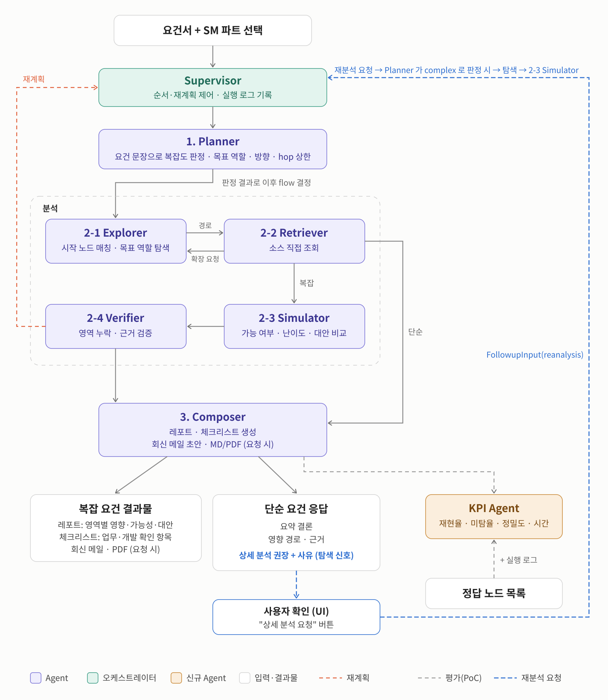

# Agent 설계서 (에이전트 단위)

> 담당: **Supervisor · 1 Planner · 2-1 Explorer · 2-2 Retriever · UI** (본인) / 2-3 Simulator · 2-4 Verifier · 3 Composer · KPI Agent (파트너)
> 스키마·필드명은 가안이며 그래프 적재 범위·프롬프트가 확정되면 조정한다.

## 0. 한눈에 보기



- 흐름: 요건서 + SM 파트 → Supervisor → 1 Planner(복잡도·탐색 명세) → 2-1 Explorer ⇄ 2-2 Retriever(경로 / 확장 요청) → 단순은 3 Composer, 복잡은 2-3 Simulator → 2-4 Verifier(보완 필요 시 재계획) → 3 Composer.
- KPI Agent (점선, 평가 PoC): 분석 흐름의 단계가 아니라 **별개로 측정**한다. Composer 이후 실행 결과·실행 로그를 정답 경로 목록(`AnswerKey`)과 비교해 재현율·미탐율·정밀도·시간을 내고, 결과는 Composer 에 전달하지 않는다 (`agents/supervisor.py`: `… → COMPOSER → KPI → END`).
- 후속 입력(현업 답변·개발 의견·조회 결과)은 START 에서 바로 Composer 로, 변경 분석·재분석 요청은 Planner 로 간다 (그림에는 없음).

```
UserInput (요청 문장 · SM 선택 · 확정 매핑)
  └ Supervisor (LangGraph) ──────────────────── 실행 로그(시간·tool·토큰) 기록, checkpointer 로 세션 보관
      1 Planner      LLM  요건 → 탐색 명세 (항목·언급 표현·변경 유형 → 목표 역할·방향·hop 상한)
      2-1 Explorer   규칙+ReAct 언급 표현 → 시작 노드 → 목표 역할까지 경로 ┐ 재탐색 ≤ 3회
      2-2 Retriever  규칙+ReAct 경로 노드 원문·정의서 → 근거 / 재탐색 요청  ┘ tool ≤ 20회
      2-3 Simulator  (복잡) 영역별 영향·가능성·난이도·대안
      2-4 Verifier   (복잡) 영역 누락·근거 검증 ─ 보완 필요 → Planner (재계획 ≤ 2회)
      3 Composer     단순 응답 / 레포트·체크리스트·회신 메일
      KPI Agent      정답 경로 대비 평가 (PoC)
```

| 에이전트 | LLM | 입력 (AgentState) | 출력 | 구현 |
|---|---|---|---|---|
| Supervisor | - | UserInput | AgentState 전체 | `agents/supervisor.py` |
| Planner | gpt-6.1-sol | user_input, followups, replan_feedback | `PlannerOutput` | `agents/planner.py`, `prompts/planner.md`, `rules.py` |
| Explorer | gpt-6.1-sol (ReAct 보완) | planner.items, retriever.reexplore_request | `ExplorerOutput` | `agents/explorer.py`, `tools/graph.py` |
| Retriever | gpt-6.1-sol (ReAct 보완) | explorer.paths, planner.items | `RetrieverOutput` | `agents/retriever.py`, `tools/source.py` |
| Simulator | (파트너) | explorer, retriever | `SimulationOutput` | `agents/simulator.py` |
| Verifier | (파트너) | simulation | `VerifierOutput` | `agents/verifier.py` |
| Composer | (파트너) | 전체 | `ComposerOutput` | `agents/composer.py` |
| KPI Agent | - | 전체 + 정답 경로 | `KpiOutput` | `agents/kpi.py` |

### 설계 기술 반영 (상세 설계서 "핵심 에이전트 기술 스택" 중 담당 범위)

| 구분 | 기술 | 반영 위치 |
|---|---|---|
| 페르소나 | 시스템 공통(역할·목표·톤·제약) + 에이전트별 페르소나 표 | `prompts/_common.md` (BaseAgent 가 모든 프롬프트 앞에 붙임), `prompts/{planner,explorer,retriever}.md` |
| Agent Framework | LangGraph: Supervisor = 진입 라우팅 + 노드 뒤 조건부 엣지 함수, MemorySaver checkpointer | `agents/supervisor.py` (`Supervisor.followup`) |
| Planner | Few-shot (Brown et al. 2020): 판정 규칙 나열 대신 complex 2 / simple 3 판정 예시 | `prompts/planner.md` |
| Planner·Supervisor | Reflexion (Shinn et al. 2023): Verifier 사유를 `replan_feedback` 에 누적, 재계획 시 이전 탐색 명세 + 누적 사유를 함께 전달 | `supervisor._verifier_node`, `planner.user_message` |
| Explorer·Retriever | ReAct (Yao et al. 2023): 규칙 단계 결과를 Observation 으로 주고 Thought → Action → Observation 반복, 예시 궤적 1개 | `agents/react.py`, `explorer._react`, `retriever._react`, `ExplorerOutput/RetrieverOutput.react_trace` |
| Output Parsing | Structured Output (Pydantic): `PlannerDraft`, `ExplorerDecision`, `RetrieverDecision` | 각 agent 모듈 |

- 규칙 단계는 그대로 두고 ReAct 는 **빠진 곳 보완**만 한다 (매칭 실패·목표 미도달·잘린 원문·경로 밖 연결). LLM 키가 없거나 `REACT=0` 이면 규칙 단계만.
- Explorer ReAct 는 tool 한도 중 3회(`RESERVED_FOR_RETRIEVER`)를 Retriever 몫으로 남긴다. Retriever ReAct 는 탐색 범위 안 노드만 `read_source`, 범위 밖은 `request_reexplore`(`next_target`)로만.
- 후속 입력: 답변·의견·조회 결과 → Composer, 변경 분석·재분석 → Planner. 최근 `MEMORY_WINDOW_N` 개만 유지.
- 범위 밖: RAG(벡터 DB)는 쓰지 않기로 함, Monitoring(Langfuse/LangSmith) 미확정, Simulator·Verifier·Composer 프롬프트 기법은 파트너 담당.

상수 (`schemas/schemas.json#/constants`): `MAX_EXPLORE_LOOP` 3, `MAX_REPLAN` 2, `MAX_TOOL_CALLS` 20, `MAX_HOPS_FORWARD` 5, `MAX_HOPS_BIDIRECTIONAL` 10, `MEMORY_WINDOW_N` 5.

---

## 1. Supervisor

**역할**: 순서·분기·재계획 제어. 분석 판단은 하지 않는다 (LLM 미사용, LangGraph 조건부 엣지).

**입력**: `UserInput { request_text, sm_part(product|marketing), output_options, confirmed_nodes[{phrase, node_id}] }`

**처리**
1. Planner 실행 → `confirmed_nodes` 를 같은 표현의 `Mention.confirmed_node` 에 반영 (사용자가 확정한 매핑 우선).
2. plan 에 Explorer 가 있으면 Explorer ⇄ Retriever 루프
   - 매 라운드 새로 시작 (`state.explorer = state.retriever = None`)
   - Retriever 의 `reexplore_request` 가 없거나, `MAX_EXPLORE_LOOP` 또는 `MAX_TOOL_CALLS` 에 닿으면 종료
3. `simple` → 종료 / `complex` → Simulator → Verifier → `needs_supplement` 면 `replan_feedback` 누적 후 Planner 로 (`MAX_REPLAN` 까지)
4. Composer → KPI Agent (평가 PoC, 결과는 Composer 에 전달하지 않음)
5. 에이전트마다 `AgentRunRecord { agent, latency_ms, tool_calls, input_tokens, output_tokens }` 기록

**한도·예외**: tool 호출은 에이전트 출력의 `tool_call_count` 를 `state.tool_call_count` 에 누적해서 관리. `analyze(user_input, until="retriever")` 로 지정 단계까지만 실행 가능 (뒷단 미구현 상태 확인용).

---

## 2. Planner (1)

**역할**: 요청을 구조화하고, Explorer 가 쓸 **탐색 명세**를 만든다. 그래프를 모르는 상태에서 판단하므로 **노드 ID 를 정하지 않고 "무엇을 말했는지"만** 넘긴다.

**입력**: 요청 문장, SM 선택, 후속 입력, 재계획 피드백

**처리**
1. LLM(`gpt-6.1-sol`, OpenAI Structured Outputs)이 `PlannerDraft` 를 채운다: 구조화 요청, 복잡도·근거, 요건 항목(문장·`change_type`·언급 표현·그래프 밖 영역), 공통 제외 여부.
2. 코드가 판단 기준표로 나머지를 채운다 (LLM 판단 일관성 확보)
   - 항목별 `target_role`·`direction`·`hop_cap` ← `rules.CHANGE_TYPE_RULES`
   - `domains` ← `rules.SM_PART_DOMAINS` (marketing → tos, product → swing)
   - `plan` ← 복잡도 (simple: explorer·retriever / complex: + simulator·verifier)

**요건 유형 → 목표 역할**

| change_type | 의미 | 목표 역할 | 방향 | hop |
|---|---|---|---|---|
| `screen_change` | 화면 입력·표시 변경 | EntryHandler | forward | 5 |
| `logic_change` | 검증·처리 로직 변경 | Logic | forward | 5 |
| `query_field_add` | 조회 결과 항목 추가 | DataAccess | forward | 5 |
| `data_add` | 저장 데이터 추가 | Table | forward_then_reverse | 10 |
| `column_spec_change` | 컬럼 길이·타입 변경 | Entry | reverse | 5 |
| `batch_change` | 배치 처리 변경 | DataAccess | forward | 5 |
| `interface_field_add` | 연계 항목 추가 | Entry | reverse (+그래프 밖) | 5 |
| `ops_cause` | 운영 이슈 원인 확인 (추가) | Table | forward | 5 |
| `structure_query` | 구조·데이터 위치 질의 (추가) | Column | forward | 5 |

**언급 표현 (`Mention`)**: `kind`(Screen/Batch/Function/Table/Column/Interface/Term), `phrase`(요건 표현 그대로), `maybe_new`, `synonyms`(현업·시스템 표현, 반대 개념 포함), `meaning`, `area`, `confirmed_node`(Supervisor 가 채움)

**출력 `PlannerOutput`**: `structured_request`, `complexity`, `complexity_reason`, `domains`, `items[ExploreItem]`, `exclude{is_common}`, `plan`

```json
{"item_id": 1, "text": "캠페인 등록 화면에 비마케팅 여부 입력 추가", "change_type": "data_add",
 "mentions": [{"kind": "Screen", "phrase": "캠페인 등록 화면", "synonyms": ["캠페인 등록"]},
              {"kind": "Column", "phrase": "비마케팅 여부", "maybe_new": true, "synonyms": ["마케팅 여부", "광고 여부"],
               "meaning": "메시지가 마케팅 목적인지 구분하는 Y/N 값"}],
 "target_role": "Table", "direction": "forward_then_reverse", "hop_cap": 10, "out_of_graph": []}
```

**한도·예외**: `OPENAI_API_KEY` 가 없으면 즉시 오류 (CLI `--plan` 으로 준비한 PlannerOutput 을 넣어 Explorer 이후만 확인 가능). 프롬프트 예시는 평가 시나리오와 무관한 가상 요건만 쓴다 (평가 오염 방지).

---

## 3. Explorer (2-1)

**역할**: 탐색 명세의 언급 표현을 그래프 노드로 매칭하고, 목표 역할까지 경로를 찾는다. 요건 유형 판단은 하지 않는다. 규칙 단계 뒤 ReAct 보완 단계에서 LLM 사용 (매칭 실패·목표 미도달·진입점·언급 값의 컬럼·공통코드 점검).

**입력**: `planner.items`, `planner.domains`, `planner.exclude`, 재탐색이면 `retriever.reexplore_request` + 이전 `explorer`

**tool**: `search_graph_nodes(terms, domains, labels, top_k)`, `traverse_graph(start_ids, direction, target_role, hop_cap, exclude_common, focus_ids, writes_only)`, `get_node_detail(node_id)`

### 3-1. 그래프 모델


- 그림 = 0 진입 ~ 5 컬럼 단계의 기본 구조 (화면 이동 OPENS 포함). 그림에 없는 확장 관계: tos Controller -EXECUTES→ SQL(★ 매퍼 직접 호출), swing Batch -INVOKES→ Module·TP(★ 배치의 모듈·서비스 재사용). Table -REFERENCES→ Table 은 DDL 에 FOREIGN KEY 가 있는 tos 에만 있다. 전체 패턴은 [mock_data.md](mock_data.md).
- 노드 = 영역별 라벨 + **공통 역할 라벨** (`:Node:Controller:EntryHandler`, 속성 `role`)

| 역할 | tos | swing |
|---|---|---|
| Entry | Screen, Batch | Screen, Batch |
| EntryHandler | Controller | TP |
| Logic | Service | Module |
| DataAccess | SQL(XML·Pro*C·Job SQL), DBIO | DBIO |
| Table / Column | Table / Column | Table / Column |

- 엣지: CALLS, OPENS(화면→화면), INVOKES, EXECUTES, READS, WRITES(속성 `columns`), REFERENCES, HAS_COLUMN
- 노드 속성 `is_common`(공통 유틸·모듈·코드), `search_text`, `terms`(용어사전)

### 3-2. 시작 노드 매칭
1. `confirmed_node` 가 있으면 그대로 (`match_source=confirmed`)
2. 없으면 `search_graph_nodes` (언급마다 1회): Neo4j full-text 인덱스 `node_search`(`search_text`, cjk 분석기 = 한글 2글자 단위 부분 일치)로 후보를 모으고 점수를 다시 매긴다.
   - 표현 점수 = 통째로 포함 1, 아니면 2글자 단위 일치 비율
   - 가중치: 요건 원문 표현 1, 동의어 2글자 0.8·3글자 0.9·4글자 이상 1 / 다른 표현이 함께 통째로 맞으면 +0.05씩 / 용어사전 일치 1
   - 채택: 0.5 이상 · 1등의 80% 이상 · 언급마다 최대 3개. 검색 대상 라벨은 `kind` 로 제한
3. 못 찾으면 `unresolved` 에 "매칭 실패" (`maybe_new` 면 "신규 후보")

### 3-3. 탐색 규칙

| 구분 | 규칙 |
|---|---|
| forward | 목표 역할보다 진입 쪽 시작 노드에서 정방향 |
| reverse | 목표 역할보다 DB 쪽 시작 노드에서 역방향. 언급으로 찾은 진입점(예: 연계 배치)은 언급 컬럼까지 정방향으로도 확인 |
| forward_then_reverse | 정방향으로 목표(수정 대상)를 찾고, 언급 컬럼(없으면 도달·언급 테이블)에서 Entry 까지 역방향. 테이블에서 출발하면 WRITES 만 |
| 멈춤 | 목표 역할 도달(`target_reached`). 목표를 건너뛰면 건너뛴 노드에서(`nearest_role`, 예: tos Batch→SQL 은 Logic 없음) |
| hop | 역할이 바뀌는 단계만 센다 (자기 호출·화면→화면 제외). 상한 도달은 `hop_cap` + `frontier` |
| 순환 | 경로 안 방문 노드로 막음. 경로가 다르면 따로 기록 (최대 300) |
| 화면 이동 | OPENS 는 시작 화면에서 한 단계만 |
| 공통 제외 | `exclude.is_common` 이면 공통 노드 확장 안 함 → `excluded_common` (시작 노드는 예외) |
| 컬럼 | 목표가 Column 일 때만 확장: 언급 컬럼 → 접근 엣지 `columns` → 시작 테이블이면 전체 |
| 역방향 컬럼 필터 | Column → Table → SQL/DBIO 는 그 컬럼을 읽거나 쓰는 엣지만 |
| 그래프 밖 | `out_of_graph` 는 탐색 안 함 → `unresolved` |

### 3-4. 재탐색
Retriever 요청을 받아 이전 결과에 이어서 탐색한다. `continue` 는 hop 상한으로 끊긴 경로에 새 경로를 이어 붙여 하나로 만든다.

**출력 `ExplorerOutput`**: `start_nodes[{item_id, node_id, matched_keyword, match_source, score, reason}]`, `nodes`, `edges`, `paths[{item_id, nodes(진입→DB), direction, reached_role, stop_reason}]`, `item_results[{reached, hops_used, frontier, unmatched_mentions}]`, `excluded_common`, `unresolved`, `hops_used`, `tool_call_count`

**한도·예외**: tool 호출이 남은 한도를 넘으면 이후 탐색을 생략하고 `unresolved` 에 기록. 저장소는 Neo4j(기본) 또는 `GRAPH_BACKEND=csv`(개발·테스트).

---

## 4. Retriever (2-2)

**역할**: 경로 노드의 소스·화면·인터페이스 정의서 **원문을 직접 읽어** 근거로 Simulator 에 넘긴다. 벡터 검색 없음. 규칙 단계 뒤 ReAct 보완 단계에서 LLM 사용 (잘린 원문 더 읽기, 경로 밖 연결은 재탐색 요청).

**입력**: `explorer.start_nodes`, `explorer.paths`, `explorer.item_results`, `planner.items`

**tool**: `read_source(node_ids, context_lines)`

**처리**
1. 시작 노드 + 경로 노드를 한 번에 읽는다 (최대 80개, 초과분은 근거 없음으로)
   - 위치: `SOURCE_ROOT_<DOMAIN>` / `source_file` 의 `source_line` 부터 노드 범위
   - Screen 은 연결 js, Batch 는 실행 프로그램(tos `.pc`, swing `program/*.pgm`)을 이어 붙임. Column 은 DDL 줄 + 코멘트
   - 노드 `interfaces` 가 있으면 정의서(`DOCS_ROOT_<DOMAIN>/interface`, 파일명 = ID 또는 파일 안 `INTERFACE <ID> … END INTERFACE` 블록)도 (`source_kind=interface_spec`)
2. `Evidence { node_id, file_path, symbol, location(L시작-끝), summary, source_kind, domain, content(원문) }`
3. 재탐색 요청

| mode | 조건 | 요청 |
|---|---|---|
| continue | 항목에 `frontier`(hop 상한) | frontier 에서 같은 목표로 이어서 |
| reverse | 정방향 항목인데 시작 노드가 모두 목표보다 DB 쪽이라 경로 없음 | 그 노드에서 Entry 까지 |
| next_target | (ReAct) 원문에서 탐색 범위 밖 연결을 발견 (`[경로 밖 연결]` 의 노드) | 지정한 목표 역할·방향까지 |

**출력 `RetrieverOutput`**: `evidence`, `nodes_without_evidence`, `reexplore_request[{item_id, mode, node_ids, target_role, direction, reason}]`, `tool_call_count`, `react_trace`

---

## 5. 파트너 담당 (인터페이스만)

| 에이전트 | 받는 것 | 내는 것 |
|---|---|---|
| Simulator | `explorer.paths`(경로), `retriever.evidence[].content`(원문), `explorer.unresolved`(분석 범위 밖) | `SimulationOutput` 영역별 영향·가능성·난이도·대안, `unverified_segments` |
| Verifier | `simulation` | `VerifierOutput` pass / needs_supplement + `additional_scope` (→ Planner 재계획) |
| Composer | 전체 | `ComposerOutput` 단순 응답 / 레포트·체크리스트·회신 메일·PDF |
| KPI Agent | 전체 + 정답 경로(`eval/ground_truth/*.json`) | `KpiOutput` 경로 재현율·Critical 미탐율·정밀도, 실행 로그 성능 |

---

## 6. 데이터·적재 (공통 기반)

- 그래프: `scripts/build_graph.py` (공통 파서 뼈대 `scripts/graph/common.py` 위의 영역별 파서 → 공통 검증 → `data/graph` → `--load` Neo4j). 노드 688 · 관계 850. 노드 ID 규칙 `<접두어>:<키>` ([mock_data.md](mock_data.md))
- swing 한글 이름·설명: `data/docs/swing/` 정의서(테이블·프로그램·화면·배치)에서 읽어 `search_text`·`is_common` 에 반영
- 적재 시 추가: 역할 라벨, `is_common`, `search_text`, full-text 인덱스 `node_search`(cjk)
- **용어사전** `data/glossary/<영역>.csv` (`term, synonyms(|), node_id, note`) → 노드 `terms` + 검색 인덱스
  - 업무용어 ↔ 노드 매핑은 프롬프트가 아니라 그래프에 둔다 (고칠 위치 한 곳)
  - 1차 수기(SM 담당) → 향후 컬럼 코멘트·화면명 기반 초안 자동 생성, 임베딩 매칭
  - 평가 시나리오 정답 매핑은 넣지 않는다

## 7. 스키마 변경 요약

| 모델 | 변경 |
|---|---|
| enums | `NodeRole`, `ChangeType`, `Direction`, `MentionKind`, `MatchSource`, `StopReason`, `ReexploreMode` |
| `UserInput` | + `confirmed_nodes` |
| `PlannerOutput` | + `domains`, `items[ExploreItem]`, `exclude` (`Mention`, `ExploreItem`, `ExcludeOption` 신규) |
| `GraphNode` / `GraphEdge` | + `role` / + `properties` |
| `StartNodeChoice` | + `item_id`, `match_source`, `score` |
| `ExplorerOutput` | + `paths`, `item_results`, `excluded_common`, `unresolved` / − `hop_extension_reason` |
| `Evidence` | + `content` / − `score` |
| `ReexploreRequest` | + `item_id`, `mode`, `target_role`, `direction` |
| `RetrieverOutput` | + `tool_call_count` |
| tool | `expand_graph` → `traverse_graph`, `search_source` → `read_source` |

`python scripts/export_schema.py --write` 로 `schemas.json` 갱신, `tests/test_schema_sync.py` 가 일치 검사.

## 8. 실행·검증

```bash
python scripts/build_graph.py --load
python -m impact_agent --case SC-001 --until retriever                 # Planner(LLM)부터
python -m impact_agent --case SC-001 --until retriever --plan p.json   # LLM 없이
python -m impact_agent ... --confirm "비마케팅 여부=COL:TCP_MSG_SCRT.ADVT_YN" --out state.json
pytest                                                                 # 가짜 그래프·LLM (Neo4j 불필요)
```

시나리오 평가 (Neo4j, 실제 LLM, Retriever 까지):

```bash
PYTHONPATH=src python3 scripts/YJ/run_scenarios.py SC-001 SC-003 SC-006 H-1 M-2 L-3 SC-004 SC-005 M-4 L-1
PYTHONPATH=src python3 scripts/YJ/run_guardrail.py
```

결과 (10건, v2): 경로 재현율 0.73 (규칙만 0.26) · Critical 미탐 6/16 · must_find 0.84 · 근거율 0.86 · 복잡도 일치 7/10, 가드레일 30/30. 케이스별 기록은 `outputs/runs/YJ/` ([README](../outputs/runs/YJ/README.md)).

## 9. 남은 과제

1. Retriever 반복 읽기: 다시 읽을 때 이미 본 줄 이후부터 보여 주기 (같은 노드를 잘린 앞부분만 반복해서 읽음)
2. Retriever 가 원문에서 찾은 연결(테이블·컬럼)을 `next_target` 재탐색으로 넘겨 그래프 경로에 반영
3. 재탐색 라운드 근거 누적 (덮어쓰기 대신 병합), 근거 중복 병합
4. Explorer ReAct 는 점검 신호가 있을 때만 시작 (지연), 분석 대상이 없는 입력은 Supervisor 에서 조기 종료
5. 복잡도: 탐색 결과로 다시 판정하는 단계, 케이스당 3회 반복 평가
6. Supervisor: 입력 정리(`input_meta`: 입력 출처·유형·분석 시점) 미구현, Composer `reanalysis_request` → Planner 재분석 라우팅 미구현, 에이전트 실패(예외) 시 대체 흐름 없음, tool 호출 한도 계산이 Explorer·Retriever 안에 흩어져 있음
