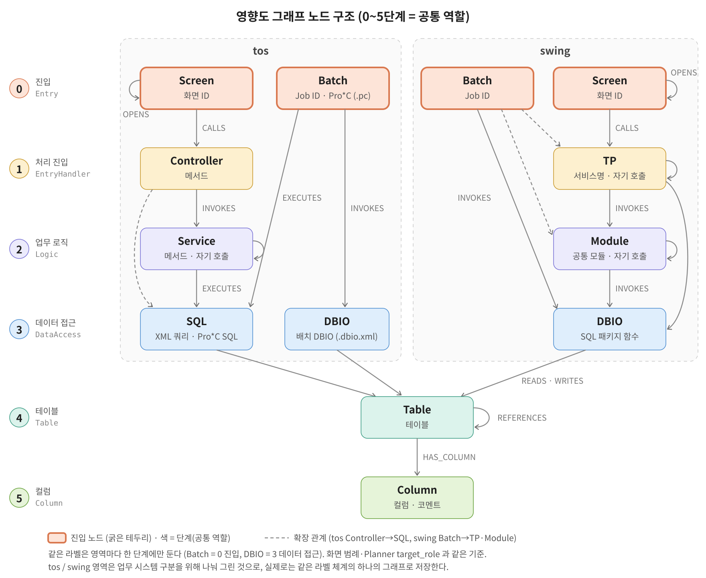

# Mockup 데이터

tos(내 목업)와 swing(파트너 목업)을 하나의 `data/` 로 합친 구조입니다. 모두 가상의 소스이며 실제 운영 소스가 아닙니다.
에이전트는 `data/` 만 읽습니다. 정답셋은 `eval/ground_truth/` 에 따로 두고 `data/` 안에는 정답 단서를 넣지 않습니다.

```
data/
├── source/<domain>/      # 소스 루트 (영역별, .env 의 SOURCE_ROOT_<DOMAIN>)
│   ├── tos/              #   실제 TOS 트리 모양: online(jsp/js/java/mapper) · batch(job/proc/dbio) · db/ddl
│   └── swing/            #   의사코드 (As-Is 상태)
│       ├── screen/       #     화면 / 출력 화면              (*.scr)  → Screen
│       ├── program/      #     서비스 / 공통 모듈 / 배치 로직 (*.pgm)  → TP, Module (배치 로직은 Batch 에 흡수)
│       ├── sql/          #     SQL 패키지 (PL/SQL)            (*.sql)  → DBIO (PACKAGE BODY 의 함수)
│       ├── table/        #     테이블 DDL                     (*.sql)  → Table, Column (자동)
│       ├── code/         #     공통코드 데이터                (*.sql)  → Column 속성 (code_values)
│       └── batch/        #     배치 Job 정의 + Job 등록 데이터 (*.bat) → Batch
├── docs/<domain>/        # 문서 루트 (영역별, .env 의 DOCS_ROOT_<DOMAIN>)
│   ├── tos/              #   batch · interface · ops · table 정의서 (*.md)
│   └── swing/            #   table · program · screen · batch 정의서 (*.md, 한글 이름·설명) · interface 스펙 (*.if)
├── snapshot/<domain>/    # 운영 DB 조회 결과 (tos 만 있음)
├── graph/                # 그래프 시드 (swing + tos). nodes.csv · edges.csv · seed.cypher
└── neo4j/                # Neo4j 런타임 데이터 (docker-compose 가 마운트하는 유일한 저장소)
```

- 노드의 `source_file` 은 **해당 영역 소스 루트 기준 상대경로**입니다 (예: domain `swing`, `batch/ZCMBBB0100010.bat` → `data/source/swing/batch/ZCMBBB0100010.bat`).
- 소스는 모두 **요건 반영 전(As-Is)** 상태입니다. 요건이 "무엇을 바꿔야 하는지"는 `eval/ground_truth/` 에만 기록합니다.
- 방해(노이즈) 소스도 일반 소스와 똑같은 모습으로 섞어 둡니다. 노이즈 여부는 정답셋에만 적습니다.
- 노드에는 원문이 `code` 속성으로도 들어 있습니다. Retriever 는 `source_file`/`source_line` 으로 원문을 직접 읽어 Simulator 에 넘깁니다.
- 소스에는 **그래프용 주석이 없습니다 (tos · swing 공통)**. 노드 ID·호출 관계·업무 규칙을 주석으로 적지 않고, 영역별 파서(`scripts/graph/parse_tos.py` · `parse_swing.py`)가 실제 코드 관례를 읽어 노드/엣지를 만듭니다 (근거 목록은 각 파서 머리말).

## 노드 ID 규칙 (공통, 2026-10-25 고정)

형식은 `<접두어>:<키>` 하나입니다. 정답셋·KPI 가 이 ID 로 매칭하므로 파서를 바꾸거나 소스를 운영 소스처럼 바꿔도 같은 대상은 같은 ID 가 나와야 합니다.

| Label | 영역 | ID 형식 | 예 |
|---|---|---|---|
| Screen | 공통 | `SCR:<화면ID>` | `SCR:TOSCP0110M`, `SCR:ZCUSSS0100010` |
| Controller | tos | `CTL:<클래스>.<메서드>` | `CTL:CmpnController.saveCmpn` |
| Service | tos | `SVC:<클래스>.<메서드>` | `SVC:CmpnService.saveCmpn` |
| SQL | tos | 매퍼: `SQL:<매퍼>.<문ID>` | `SQL:MsgScrtMapper.insertMsgScrt` |
| | | Pro\*C 커서: `SQL:<프로그램>.<커서명>` | `SQL:tbch1010.C_SND` |
| | | Pro\*C 이름 없는 SQL: `SQL:<프로그램>.<함수>` | `SQL:tbtw1010.ins_if_file_log` |
| | | Job SQL 단계: `SQL:<JobID>.<단계ID>` | `SQL:TBCP5010.STEP01` |
| TP | swing | `TP:<클래스>.<메서드>` | `TP:ProdScrbSvc.scrbProd` |
| Module | swing | `MOD:<클래스>.<메서드>` | `MOD:ProdScrbSvc.checkAgeLimit` |
| Batch | 공통 | `BAT:<JobID>` | `BAT:TBTW1010`, `BAT:ZDOCBB0100010` |
| DBIO | 공통 | tos: `DBIO:<DBIO ID>` / swing: `DBIO:<매퍼>.<문ID>` | `DBIO:DCP_MSGSCRT_S02`, `DBIO:SvcProdSql.insertSvcProd` |
| Table | 공통 | `TBL:<테이블>` | `TBL:TCP_MSG_SCRT` |
| Column | 공통 | `COL:<테이블>.<컬럼>` | `COL:TCP_MSG_SCRT.ADVT_YN` |

- 키는 소스 표기 그대로 씁니다 (메서드·프로그램은 대소문자 유지, 테이블·컬럼·화면·Job ID 는 대문자).
- 클래스·매퍼는 패키지/namespace 를 뺀 단순 이름입니다.
- 메서드 오버로딩: 같은 이름이 둘 이상이면 해당 메서드 전부에 파라미터 타입을 붙입니다. 예: `SVC:CmpnService.selectMsgScrt(String)`, `SVC:CmpnService.selectMsgScrt(MsgScrtVO)`.
- Pro\*C 의 한 함수 안에 이름 없는 SQL 이 둘 이상이면 등장 순서대로 `#2`, `#3` 을 붙입니다 (첫 번째는 붙이지 않음).
- 노드가 아닌 것: JS 함수(→ Screen 의 `events`), MyBatis `<sql>` 조각(→ 쓰는 SQL 에 흡수), Pro\*C 함수(→ Batch 에 흡수), Job 단계(→ Batch), 인터페이스 항목(→ Batch/TP/Module 의 `interfaces`).
- ID 에 영역(domain)은 넣지 않고 `domain` 속성으로 구분합니다. 영역 간 ID 가 겹치면 그래프 빌드를 실패시킵니다.

## 그래프 노드 구조 (공통)



- 0 진입 → 1 처리 진입 → 2 업무 로직 → 3 데이터 접근 → 4 테이블 → 5 컬럼 단계로, tos·swing 은 같은 라벨 체계의 하나의 그래프에 저장한다 (공통 역할 라벨: Entry · EntryHandler · Logic · DataAccess · Table · Column).
- 같은 라벨은 영역마다 한 단계에만 둔다: Batch 는 Screen 과 같은 0 진입(Entry), Batch 가 부르는 DBIO 도 3 데이터 접근(DataAccess). 화면 범례·Planner `target_role` 과 같은 기준 (`scripts/graph/model.py` `LABEL_ROLE`).
- ★ 확장 패턴(tos Controller→SQL, swing Batch→Module·TP)은 그림에서 점선, 아래 영역별 표에서 ★ 로 표시한다.

## 그래프 모델 (swing)

```
단계 (공통 역할)   swing 라벨
0 Entry           Screen, Batch
1 EntryHandler    TP
2 Logic           Module
3 DataAccess      DBIO
4 Table           Table
5 Column          Column

Screen ──OPENS──▶ Screen
Screen ──CALLS──▶ TP ──CALLS──▶ TP (자기 호출)
TP ──INVOKES──▶ Module ──INVOKES──▶ Module (자기 호출)
TP ──INVOKES──▶ DBIO          Module ──INVOKES──▶ DBIO
Batch ──INVOKES──▶ DBIO       Batch ──INVOKES ★──▶ TP · Module
DBIO ──READS/WRITES──▶ Table ──HAS_COLUMN──▶ Column      Table ──REFERENCES──▶ Table
```

| Label | ID 형식 | 예 | 출처 (코드 관례) |
|---|---|---|---|
| Screen | `SCR:<화면ID>` | `SCR:ZCUSSS0100010` | `screen/*.scr` 의 `SCREEN <화면ID> "<화면명>"` |
| TP | `TP:<프로그램>.<함수>` | `TP:ProdScrbSvc.scrbProd` | `program/*.pgm` 의 `FUNCTION` 중 **화면 EVENT 가 직접 CALL 하는 함수** |
| Batch | `BAT:<JobID>` | `BAT:ZDOCBB0100010` | `batch/*.bat` 의 `JOB`. `PROGRAM <프로그램>.<함수>` 의 실행 함수를 흡수 |
| Module | `MOD:<프로그램>.<함수>` | `MOD:ProdScrbSvc.checkAgeLimit` | 그 밖의 `FUNCTION` (내부·공통 로직) |
| DBIO | `DBIO:<패키지>.<함수>` | `DBIO:SvcProdSql.insertSvcProd` | `sql/*.sql` 의 `PACKAGE BODY` 안 `FUNCTION`/`PROCEDURE` |
| Table | `TBL:<테이블>` | `TBL:TB_SVC_PROD` | `table/*.sql` 의 `CREATE TABLE` |
| Column | `COL:<테이블>.<컬럼>` | `COL:TB_SVC.SVC_CL_CD` | DDL 컬럼 정의에서 자동 생성 |

| 엣지 | 패턴 | 근거 (코드 관례) |
|---|---|---|
| CALLS | Screen→TP, TP→TP | 화면 `EVENT` 안의 `CALL <프로그램>.<함수>` (속성 `event`), TP 함수 안의 TP 호출 |
| OPENS | Screen→Screen | 화면의 `OPEN <화면ID>(…)` / `POPUP <화면ID>(…)` |
| INVOKES | TP→Module, TP→DBIO, Module→Module, Module→DBIO, Batch→DBIO, Batch→Module ★, Batch→TP ★ | 함수 안의 `CALL <프로그램>.<함수>` (같은 프로그램은 `CALL <함수>`), `SQL <패키지>.<함수>` |
| READS / WRITES | DBIO→Table (속성 `columns`: SQL 에서 접근하는 컬럼 목록, 자동 계산) | PL/SQL 본문의 테이블. `INSERT INTO`/`UPDATE`/`DELETE`/`MERGE` 대상은 WRITES |
| HAS_COLUMN | Table→Column | DDL 컬럼 정의 |

★ 는 원본 구조도에 없는 확장 패턴입니다 (배치가 공통 모듈/서비스를 재사용하는 경우). 이 외 패턴은 빌드 시 경고합니다.
- Batch: Job 실행 함수(`PROGRAM`)의 호출에 더해, `LAUNCHER <기동기>` 로 기동되는 Job 은 기동기가 Job 실행(`INVOKE(…)`) 뒤 부르는 SQL(실행 결과·이력 기록)도 Batch→DBIO 로 연결합니다.
- 인터페이스: 함수 안의 `IfClient.send('<IF_ID>', …)` / `IF_ENDPOINT['<IF_ID>']` → 노드 속성 `interfaces` (이름은 `docs/swing/interface/*.if` 의 `INTERFACE <ID> "<이름>"`).
- Table→Table REFERENCES: swing DDL 에는 FOREIGN KEY 가 없어 만들지 않습니다.

## 한글 이름·설명 (정의서, swing)

swing 소스에는 한글 이름·설명이 없으므로 문서(`data/docs/swing/`)에서 읽어 노드 속성에 넣습니다. 검색(`search_text`)과 공통 판정(`is_common`)이 이 값을 씁니다.

| 정의서 | 형식 | 노드 속성 |
|---|---|---|
| `table/swing_table_def.md` | `## <테이블> <한글명>` + `설명:` + 컬럼 표(컬럼·타입·NULL·설명), 끝에 공통코드 그룹 표 | Table `name`·`desc`, Column `comment`, `code_grp_nm` |
| `program/swing_program_def.md` | 목록 표(이름·구분·한글명·설명) + `## <프로그램>` 의 함수 표(함수·설명) | TP/Module/DBIO `program_name`·`program_desc`·`desc` |
| `screen/swing_screen_def.md` | 화면 목록 표(화면·화면명·설명) + `## <화면ID>` 의 이미지 표 | Screen `desc`·`images` |
| `batch/swing_batch_def.md` | Job 표(Job·Job명·주기·설명) | Batch `cycle`·`desc` |

- 업무 규칙과 TP/Module 구분은 정의서에 쓰지 않습니다. 규칙은 에이전트가 코드에서 찾고, 라벨은 파서가 호출 관계로 정합니다.

자동 생성 속성:
- 모든 Screen/TP/Batch/Module/DBIO/Table: `code` — 해당 블록 원문 (Batch 는 Job 정의 뒤에 `// ---- program/<프로그램>.pgm ----` 와 실행 함수 원문)
- Column: `data_type`, `nullable`, `pk`, `comment`, `code_grp`, `code_grp_nm`, `code_values`
  (컬럼 설명의 `(XXX_CD: ...)` 또는 컬럼명과 같은 공통코드 그룹의 값을 `code/*.sql` 에서 읽어 채움)

화면/배치/출력 프로그램 ID 는 `Z` + 업무(3자리) + 유형(2자리) + 일련번호(7자리) 형식입니다.
유형: `SS` 화면, `RR` 출력/레포트, `BB` 배치. 업무: `CUS` 고객, `PRD` 상품, `CMB` 결합, `DOC` 구비서류, `CNT` 접촉이력, `ROM` 로밍, `PAY` 결제, `PLN` 스마트플래너, `COM` 공통.

## 의사코드 문법

언어 중립적인 간소화 문법입니다. 엄밀할 필요는 없지만 아래 키워드를 일관되게 씁니다.

```
PROGRAM ProdScrbSvc                          // 프로그램(클래스)
FUNCTION scrbProd(svcMgmtNo, prodId) -> scrbSeq
  prod = CALL ProdInfoSvc.getProd(prodId)    // 다른 메서드 호출
  rows = SQL SvcProdSql.selectSvcProdList(svcMgmtNo)   // SQL 실행
  IF prod.prodTypCd == 'ADD' THEN ... ELSE ... END IF
  FOR EACH r IN rows ... END FOR
  THROW BizException('PRD0001', '판매기간이 아닌 상품입니다.')
  RETURN scrbSeq
END FUNCTION
```

화면(`*.scr`) 은 `SCREEN / AREA / INPUT / COMBO / CHECK / GRID / COLUMN / BUTTON / LABEL / EVENT … END EVENT` 키워드로 레이아웃과 이벤트를 적고, 다른 화면은 `OPEN <화면ID>(…)` / `POPUP <화면ID>(…)` 로 엽니다.
SQL(`sql/*.sql`) 은 PL/SQL `CREATE OR REPLACE PACKAGE BODY <패키지>` 안의 `FUNCTION`/`PROCEDURE … END <이름>;`, 배치(`batch/*.bat`) 는 `JOB <JobID> "<Job명>" … PROGRAM / LAUNCHER / SCHEDULE … END JOB` 입니다.

## 그래프 모델 (tos)

`scripts/graph/parse_tos.py` 가 실제 코드 관례를 읽어 노드/엣지를 만듭니다 (근거 목록은 파일 머리말).

```
단계 (공통 역할)   tos 라벨
0 Entry           Screen, Batch
1 EntryHandler    Controller
2 Logic           Service
3 DataAccess      SQL, DBIO
4 Table           Table
5 Column          Column

Screen ──OPENS──▶ Screen
Screen ──CALLS──▶ Controller ──INVOKES──▶ Service ──INVOKES──▶ Service (자기 호출)
Service ──EXECUTES──▶ SQL     Controller ──EXECUTES ★──▶ SQL
Batch ──EXECUTES──▶ SQL       Batch ──INVOKES──▶ DBIO
SQL · DBIO ──READS/WRITES──▶ Table ──HAS_COLUMN──▶ Column      Table ──REFERENCES──▶ Table
```

| 엣지 | 근거 |
|---|---|
| Screen→Controller (CALLS) | js `tos.ajax('/x.do')` 주소 = Controller 클래스 + 메서드 매핑. 속성 `event`: 호출한 js 함수 또는 `<요소ID>.<이벤트>` |
| Screen→Screen (OPENS) | `location.href` / `tos.popup` 주소가 화면(view)을 반환하는 매핑 |
| Controller→Service, Service→Service (INVOKES) | 필드 타입이 `*Service` 인 호출, 같은 클래스 메서드 호출 |
| Controller/Service→SQL (EXECUTES) | 필드 타입이 `*Mapper` 인 호출 → 같은 이름 namespace 의 문 ID. Controller→SQL 은 ★ 확장 |
| Batch→SQL (EXECUTES), Batch→DBIO (INVOKES) | Job 단계(`type="SQL"`, `<dbio>`), PROC 단계 `.pc` 의 `EXEC SQL` / `tmk_dbio_*(DBIO_ID)`. 속성 `note`: 단계·함수 |
| SQL/DBIO→Table (READS/WRITES) | SQL 본문의 테이블. `INSERT INTO`/`UPDATE`/`DELETE`/`MERGE` 대상은 WRITES, 나머지는 READS |
| Table→Table (REFERENCES) | DDL `FOREIGN KEY` (속성 `via`) |

- Batch 노드의 `code` 는 Job XML 뒤에 PROC 프로그램(`.pc`) 원문을 붙인 것입니다. 인터페이스는 Job 의 `<ifId>` 를 `interfaces` 속성으로 둡니다.
- Column 노드의 `source_line` 은 DDL 의 해당 컬럼 줄입니다.

## 그래프 시드 생성 / 검증

```bash
python scripts/build_graph.py --strict   # 영역별 파서 → 공통 검증 → data/graph/ 갱신. 끊긴 참조·규약 외 패턴·ID 규칙 위반이 있으면 실패
python scripts/build_graph.py --load     # 생성 후 .env 의 Neo4j 에 적재 (기존 :Node 그래프 삭제 후 재적재)
```

- 구조: `scripts/graph/common.py` (**공통 파서 뼈대** `BaseParser`: 노드·관계 추가, DDL → 테이블·컬럼, SQL 본문 → READS/WRITES, 정의서 md 읽기)
  → `scripts/graph/parse_swing.py` · `parse_tos.py` (`BaseParser` 상속, 영역 언어를 읽는 부분만) → `scripts/graph/model.py` (라벨·엣지·허용 패턴·검증·출력·적재)
- 영역을 추가하려면 `BaseParser` 를 상속한 `parse_<domain>.py` 를 만들고 `build_graph.py` 의 `PARSERS` 에 등록합니다.
- `[INFO]` 는 의도된 누락(적재 범위 밖 프로그램, 매핑 없는 주소 등)이라 `--strict` 에서도 실패하지 않습니다.
- 의도된 누락 예: tos `TBCH1020`·`TBCH4020` Job 의 PROC 프로그램 `tbch1020.pc`·`tbch4020.pc` 는 소스에 넣지 않았습니다. Job 정의(`batch/job/*.xml`)만 있어 그래프에는 Batch 노드만 생기고(고립 노드), 적재 현황 화면의 "미제공 소스 영역"에 나옵니다. SC-006(발송 실패 사유 문의)에서 에이전트가 이 한계를 분석 한계로 밝히고 Job 정의·DDL·공통코드로 답하는지 보려는 것입니다.
